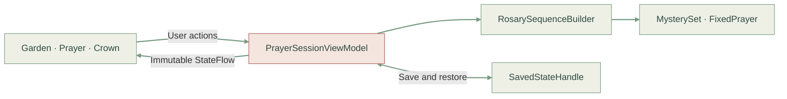

<div align="center">


# Sertum Rosarum

### Um jardim de oração, uma rosa de cada vez.

A quiet Marian garden for the Holy Rosary.<br />
Native Android, original botanical artwork, and a complete prayer experience that works offline.

[](https://github.com/mariajunqueiramirandas-cpu/Sertum-Rosarum/actions/workflows/android-ci.yml)


**[The experience](#the-experience) · [Screenshots](#a-garden-in-every-screen) · [APK releases](#automatic-apk-releases) · [Run locally](#run-it-locally) · [Validation](#validation) · [Roadmap](#roadmap)**

</div>

---

## The experience

Open Sertum and arrive in a small garden: warm cream, sage leaves, clay-colored roses, and Mary holding the Child. Choose the mysteries, settle into prayer, and watch each bead blossom. After dusk, the same garden becomes a forest sanctuary lit by a crescent moon.

*Sertum Rosarum* means “crown of roses.” That image shapes the whole app: each prayer becomes a rose, five mysteries form a crown, and the completed rosary is gently offered at the end.

**Phase 1 is implemented.** The interface and fixed prayers are in Brazilian Portuguese. Prayer content, fonts, and artwork are bundled; the prayer experience needs no network connection.

## A garden in every screen

These previews are rendered from the Android Compose screens using Robolectric native graphics. The sacred garden and coordinated botanical paintings are bundled with the app; Canvas and Foundation compose the flowers, stems, crown, icons, and controls.

<table>
  <tr>
    <th>Day · a place to arrive</th>
    <th>Vigil · the garden after dusk</th>
    <th>Prayer · one rose at a time</th>
  </tr>
  <tr>
    <td></td>
    <td></td>
    <td></td>
  </tr>
</table>

<table align="center">
  <tr>
    <th>Eyes closed · let touch guide you</th>
    <th>Delivered · carry the peace with you</th>
  </tr>
  <tr>
    <td></td>
    <td></td>
  </tr>
</table>

<details>
<summary><strong>See the compact landscape prayer view</strong></summary>

Prayer position survives rotation. Compact mystery controls preserve access to the next and previous prayers, while longer text scrolls.


</details>

<details>
<summary><strong>See the painted roses in Vigil and their bloom animation</strong></summary>

<table>
<tr><th>Prayer in moonlight</th><th>The offered crown</th></tr>
<tr>
<td></td>
<td></td>
</tr>
</table>


The animation is rendered from the Android Compose UI at controlled frame times. Ambient light and leaf movement stop when system animations are disabled.

</details>

## A complete rosary

### Arrive, contemplate, pray, and offer

1. **Find a little quiet.** The sanctuary shows today's date and automatically selects the traditional mystery set. Day, Vigil, and System appearance are available from the custom light control.
2. **Choose your contemplation.** Switch between Gozosos, Luminosos, Dolorosos, and Gloriosos. Each set includes its five mysteries, Scripture references, and spiritual fruits.
3. **Pray the whole rosary.** Follow every opening prayer, all five decades, and the closing thanksgiving and Salve Rainha. The sequence contains **59 physical beads across 80 prayer and announcement steps**.
4. **Follow the roses.** Beads bloom with a gentle spring animation. Move forward or backward, tap a particular bead, or select a mystery directly from the botanical arc.
5. **Offer the crown.** Fifty flowers surround a central rose. The closing screen shows elapsed prayer time and a peaceful return to the sanctuary.

The traditional opening includes the Sign of the Cross, offering, Apostles' Creed, Our Father, three Hail Marys for faith, hope, and charity, and Glory Be. Each decade includes its mystery announcement, Our Father, ten Hail Marys, Glory Be, and the Fatima prayer. The rosary closes with Infinitas Graças and Salve Rainha.

### Read every line at your own pace

Long prayers show a custom sage position rail, soft fades at edges with hidden text, and a **Continue lendo** cue. Tap to read the next portion with overlap, or scroll normally. At the end, **Voltar ao início** returns to the top. Reading never advances the rosary, and prayers that fit keep the entire reading area free of scroll cues.

<table>
<tr><th>More text below</th><th>End of the text</th></tr>
<tr>
<td></td>
<td></td>
</tr>
</table>

### Pray with your eyes closed

A large tactile surface occupies half the prayer screen. You can keep your attention on prayer while touch guides the sequence.

| Gesture | Action |
| --- | --- |
| Tap | Advance one prayer or bead |
| Swipe left or up | Advance |
| Swipe right | Return to the previous prayer or bead |

Haptics distinguish a small bead, a prayer or decade boundary, and the completed crown with single, double, and triple pulses. Vibration can be disabled. The tactile surface also exposes a screen-reader action.

### Pause and return gently

Returning to the sanctuary keeps the active crown available to continue. `SavedStateHandle` preserves the prayer position, mystery set, appearance selection, and tactile preferences through Android activity and saved-state recreation.

Durable history, a persistent preference store, and the intention notebook belong to Phase 4. They are separate from the current session recovery.

## Designed as a quiet garden

The visual system is **O Jardim de Maria**: a comforting place of shelter, with a soft rounded serif, gentle shapes, and an original Marian illustration.

| Element | How it is made |
| --- | --- |
| The garden | Bundled model-generated sacred paintings for day and Vigil: Mary and the Child, a rose-covered arch and stone path, with Canvas light and pollen |
| Living beads | Painted blush and ivory roses, buds that blend into blooms, sage leaves, a growing stem, fine gold selection rings, and gentle spring animations |
| Offered crown | Fifty painted roses woven with sage leaves, five ivory mystery markers, and a central rose in a quiet gold setting |
| Typography | Bundled Fraunces (soft serif, for the wordmark and prayers) and Nunito (controls), with explicit variable-font axes |
| Day | Warm cream `#FBF8F2`, sage `#789A81`, rose `#C07A72`, and blush petal actions |
| Vigil | Deep forest `#162A27`, cream `#F3EFE3`, and muted rose `#E0A99C` |
| Controls | Custom Foundation buttons, filled icon controls, press indications, mystery selectors, and appearance menu |
| Atmosphere | Peach, honey, lavender, and soft sky tints tied to the selected mystery set |

**Zero Material or Material3 components.** Both dependency groups are excluded from every configuration, including preview tooling. Colors, typography, spacing, shapes, and mystery atmosphere are provided through custom composition locals.

Read the [full design system](docs/design-system.md) for tokens, interaction rules, and accessibility details.

## Automatic APK releases

Every successful push to `main` creates a [GitHub Release](https://github.com/mariajunqueiramirandas-cpu/Sertum-Rosarum/releases) with an **optimized, signed, installable APK**, its SHA-256 checksum, and source/build metadata. Unit tests, lint, device UI tests, and a launch check of the minified app must pass before publishing.

The included stable fallback signer works without GitHub Secrets. It is an intentionally public development identity; optional private signing secrets override it on main. A different pre-existing signing certificate requires a one-time uninstall before switching to these builds.

Builds use automatic version codes, R8 code and resource shrinking, larger memory budgets, Gradle task caches, and warmed emulator snapshots. The emulator tests the APKs from the build job, so compilation happens once. Obsolete PR runs are canceled; every main run is allowed to finish and release.

See [build performance and releases](docs/build-and-releases.md) for memory budgets, signing, versioning, cache behavior, and the full pipeline.

## Run it locally

### Requirements

- **JDK 17**.
- **Android SDK 35**, including Build Tools and Platform Tools.
- An **Android 13 / API 33 or newer** device or emulator to run the app and instrumented tests.
- `ANDROID_HOME` pointing to your SDK, or an untracked `local.properties` containing `sdk.dir=/path/to/Android/Sdk`.

### Build and install

```bash
git clone https://github.com/mariajunqueiramirandas-cpu/Sertum-Rosarum.git
cd Sertum-Rosarum

# Build the development APK with the included Gradle wrapper.
./gradlew assembleDebug

# Install on a connected Android device or emulator.
adb install -r app/build/outputs/apk/debug/app-debug.apk
```

You can also open the repository root in Android Studio, select JDK 17 for Gradle, sync, and run the `app` configuration. On Windows, use `gradlew.bat`.

The debug APK is written to `app/build/outputs/apk/debug/app-debug.apk`. Build the optimized, fallback-signed APK with `./gradlew assembleRelease`; it appears at `app/build/outputs/apk/release/app-release.apk`. CI uploads **android-test-apks**, **android-release**, and build reports on the [Android CI workflow](https://github.com/mariajunqueiramirandas-cpu/Sertum-Rosarum/actions/workflows/android-ci.yml). Main builds also publish the APK on [GitHub Releases](https://github.com/mariajunqueiramirandas-cpu/Sertum-Rosarum/releases).

## Validation

Phase 1 has been verified with **18 JVM unit tests**, **9 instrumented Compose UI tests on Android 13 / API 33**, successful debug and optimized release builds, and **zero Android Lint findings**.

```bash
# Build, verify the prayer engine and session state, and run lint.
./gradlew assembleDebug testDebugUnitTest lintDebug

# Run the complete device UI suite with a connected Android 13+ device.
./gradlew connectedDebugAndroidTest
```

| Coverage | Verified behavior |
| --- | --- |
| Prayer sequence · 5 unit tests | All four mystery sets; 59 beads and 80 steps; correct opening, decade, and closing order; all seven weekdays; the twenty mysteries' metadata |
| Session state · 13 unit tests | Forward/backward boundaries; decade and bead jumps; completion timing; differentiated pulse events; pause/resume; saved-state restoration; day changes |
| Device UI · 6 flows | Appearance and mystery selection; the complete rosary; bead and decade navigation with pause/resume; eyes-closed taps and swipes; landscape recreation; long-prayer reading without advancing the rosary |
| Reader accessibility · 3 tests | Paging and return to start at 180% font size; no false scroll cues for short text in Vigil mode or content near the viewport's fit boundary |

The UI suite also captures all six views shown above. CI collects them in the **compose-ui-results** artifact before removing the test app. For fresh local captures and the same optimized release launch check, follow the [device verification instructions](docs/build-and-releases.md#local-verification); the helper saves screenshots under `app/build/outputs/screenshots`.

[GitHub Actions](.github/workflows/android-ci.yml) builds all three APKs once, runs unit tests and lint, and passes those APKs to an accelerated API 33 emulator. The device job checks the five Compose flows, saves screenshots before removing the test target, and smoke-tests the real minified release. A main-only publishing job then creates the APK release. The release automation also has 14 Python tests covering memory budgets, signing, checksums, versioning, idempotency, and publishing guards.

## Inside the app

The prayer sequence is pure Kotlin. A lifecycle-aware view model exposes immutable state, and Compose renders the garden, prayer, and delivered crown from that state.



| Layer | Location | Responsibility |
| --- | --- | --- |
| App host | [`MainActivity.kt`](app/src/main/java/com/sertumrosarum/MainActivity.kt), [`SertumApp.kt`](app/src/main/java/com/sertumrosarum/SertumApp.kt) | Edge-to-edge hosting, lifecycle-aware state, route transitions, system bars, and haptic dispatch |
| Prayer domain | [`domain/prayer`](app/src/main/java/com/sertumrosarum/domain/prayer) | Immutable fixed prayers, twenty mysteries, weekday resolution, and deterministic sequence construction |
| Prayer session | [`feature/prayer`](app/src/main/java/com/sertumrosarum/feature/prayer) | State transitions, saved-state recovery, immersive prayer, and crown delivery |
| Sanctuary | [`feature/sanctuary`](app/src/main/java/com/sertumrosarum/feature/sanctuary) | Greeting, garden, mystery controls, appearance, and session continuation |
| Design system | [`ui/theme`](app/src/main/java/com/sertumrosarum/ui/theme), [`ui/components`](app/src/main/java/com/sertumrosarum/ui/components) | Custom tokens, fonts, controls, and press feedback |
| Original artwork | [`ui/canvas`](app/src/main/java/com/sertumrosarum/ui/canvas) | Marian garden, roses, living bead arcs, and the completed crown |
| Tactile feedback | [`core/haptics`](app/src/main/java/com/sertumrosarum/core/haptics) | Android `VibratorManager` and differentiated `VibrationEffect` patterns |

### Toolchain

| Component | Version |
| --- | --- |
| Kotlin / Compose compiler plugin | 2.1.20 |
| Compose BOM | 2025.04.00 |
| Android Gradle Plugin | 8.9.1 |
| Gradle wrapper | 8.11.1 |
| Java toolchain | 17 |
| Android | Minimum 33 · Compile / Target 35 |

Versions live in [`gradle/libs.versions.toml`](gradle/libs.versions.toml). The app's package is `com.sertumrosarum`.

## Roadmap

The current app is the complete **Phase 1 vertical slice**. The following phases are planned and are not represented as shipping features.

| Phase | Milestone | Status |
| --- | --- | --- |
| **1** | Garden sanctuary, custom design system, complete rosary counter, living roses, tactile navigation, and crown delivery | **Implemented** |
| **2** | Four-dimensional mysteries, bead-by-bead meditations, prayer scripts, and devotional chaplets | Planned |
| **3** | Prayer treasury, Portuguese / Latin mode, prayer annotations, and a mystery study guide | Planned |
| **4** | Persistent intentions, prayer history, preference storage, and the personal garden | Planned |
| **5** | Lumen catechist and custom rosary supplements with doctrinal guardrails | Planned |

See [`phases.md`](phases.md) for the milestone definitions and acceptance criteria.

## Explore further

| Document | What you will find |
| --- | --- |
| [Build performance and releases](docs/build-and-releases.md) | Automatic signed APKs, memory budgets, caches, versioning, and stable fallback signing |
| [Design system](docs/design-system.md) | The current quiet garden: palette, type, artwork, motion, and accessibility |
| [Product vision](docs/product-vision.md) | The wider experience and long-term product direction |
| [Visão de produto · Português](docs/visao-de-produto-pt.md) | The original Portuguese product vision |
| [Architecture](docs/architecture.md) | The broader architecture blueprint, including later phases |
| [Liturgical content](docs/domain-and-liturgical-content.md) | Domain references, mysteries, prayers, and planned devotional content |
| [Lumen](docs/lumen-ai.md) | The planned AI catechist, content boundaries, and guardrails |

### Artwork and font credits

The home garden uses original model-generated sacred paintings, inspired by the grace and light of classical Marian art. [Full-resolution garden masters, final prompts, and the seven-round exploration](docs/artwork/garden/README.md) are preserved with the project. The [coordinated botanical paintings and prompts](docs/artwork/botanical/README.md) extend its roses, buds, and leaves through the prayer beads, crown, ornaments, and launcher. Canvas handles composition and motion; interface symbols and the themed launcher use custom vector artwork. Fraunces and Nunito are bundled from Google Fonts under their [SIL Open Font Licenses](docs/fonts).

---

<div align="center">

**Com Maria, um passo de cada vez.**<br />
*Uma oração de cada vez. Sem pressa.*

</div>
