<div align="center">


# Sertum Rosarum

### Um jardim de oração, uma rosa de cada vez.

A quiet Marian garden for the Holy Rosary.<br />
Native Android, original botanical artwork, and a complete prayer experience that works offline.

[](https://github.com/mariajunqueiramirandas-cpu/Sertum-Rosarum/actions/workflows/android-ci.yml)


**[The experience](#the-experience) · [Screenshots](#a-garden-in-every-screen) · [APK releases](#automatic-apk-releases) · [Run locally](#run-it-locally) · [Validation](#validation) · [Roadmap](#roadmap)**

</div>

---

## The experience

Open Sertum and arrive in a small garden: warm cream, sage leaves, clay-colored roses, and Mary holding the Child. Choose the mysteries, settle into prayer, and watch each bead blossom. After dusk, the same garden becomes a forest sanctuary lit by a crescent moon.

*Sertum Rosarum* means “crown of roses.” That image shapes the whole app: each prayer becomes a rose, five mysteries form a crown, and the completed rosary is gently offered at the end.

**Phases 1 and 2 are implemented.** The interface and fixed prayers are in Brazilian Portuguese. Prayer content, fonts, and artwork are bundled; the prayer experience needs no network connection.

## A garden in every screen

These previews are rendered from the Android Compose screens using Robolectric native graphics. The sacred garden, botanical paintings, and [eight devotional illustrations](docs/artwork/devotions/README.md) are bundled with the app; Canvas and Foundation compose the flowers, stems, crown, icons, and controls. Scrolling content dissolves gently beneath the fixed headers.

<table>
  <tr>
    <th>Day · a place to arrive</th>
    <th>Vigil · the garden after dusk</th>
    <th>Prayer · one rose at a time</th>
  </tr>
  <tr>
    <td>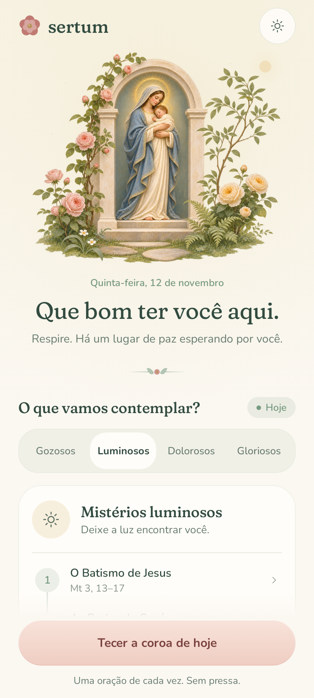</td>
    <td>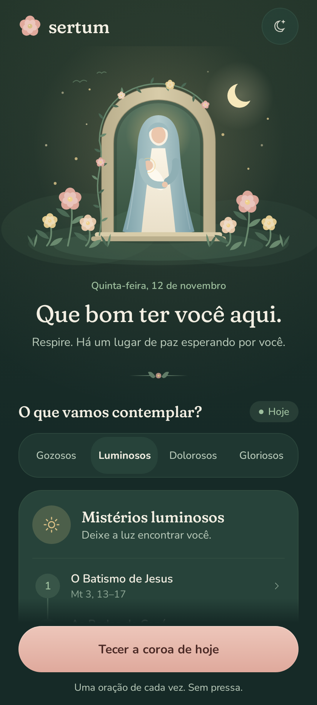</td>
    <td>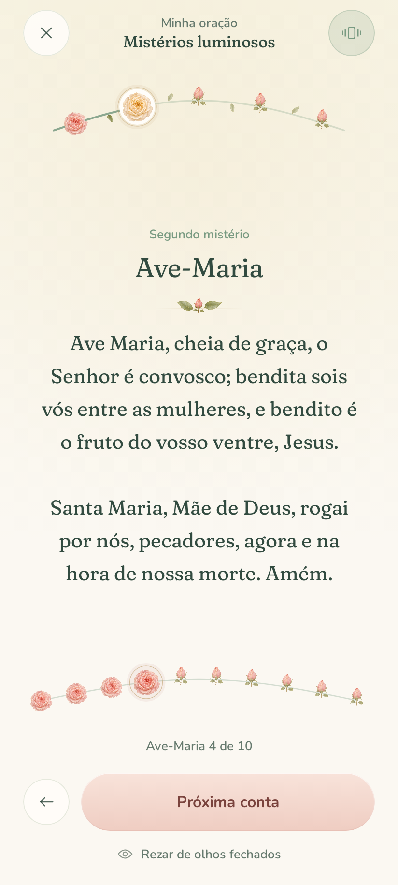</td>
  </tr>
</table>

<table align="center">
  <tr>
    <th>Eyes closed · let touch guide you</th>
    <th>Delivered · carry the peace with you</th>
  </tr>
  <tr>
    <td>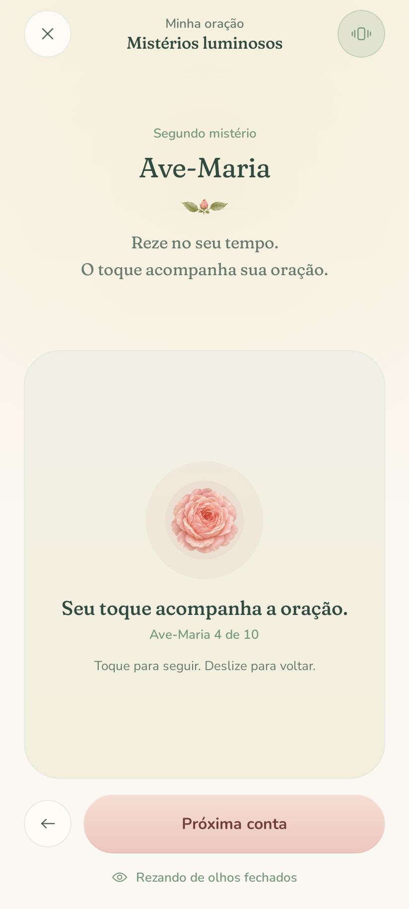</td>
    <td>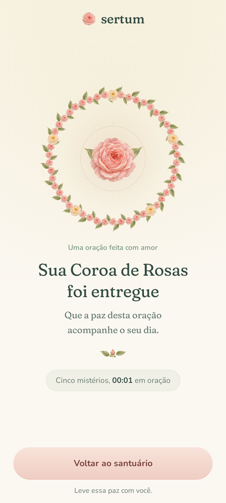</td>
  </tr>
</table>

<details>
<summary><strong>See the compact landscape prayer view</strong></summary>

Prayer position survives rotation. Compact mystery controls preserve access to the next and previous prayers, while longer text scrolls.

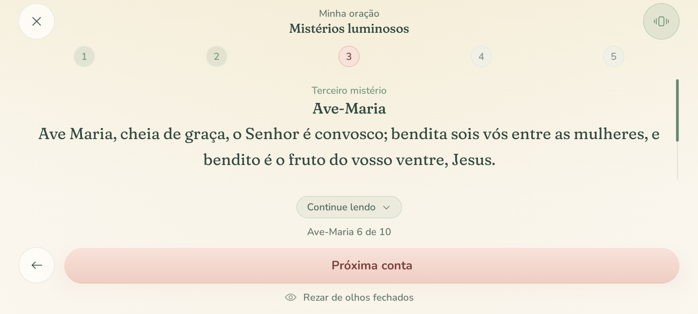

</details>

<details>
<summary><strong>See the painted roses in Vigil and their bloom animation</strong></summary>

<table>
<tr><th>Prayer in moonlight</th><th>The offered crown</th></tr>
<tr>
<td>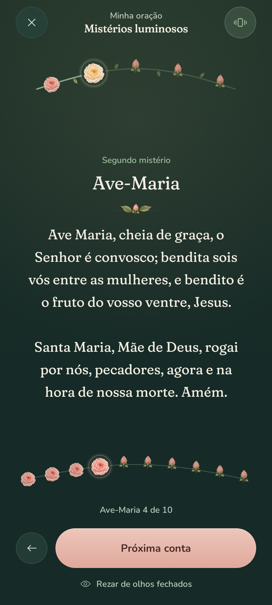</td>
<td>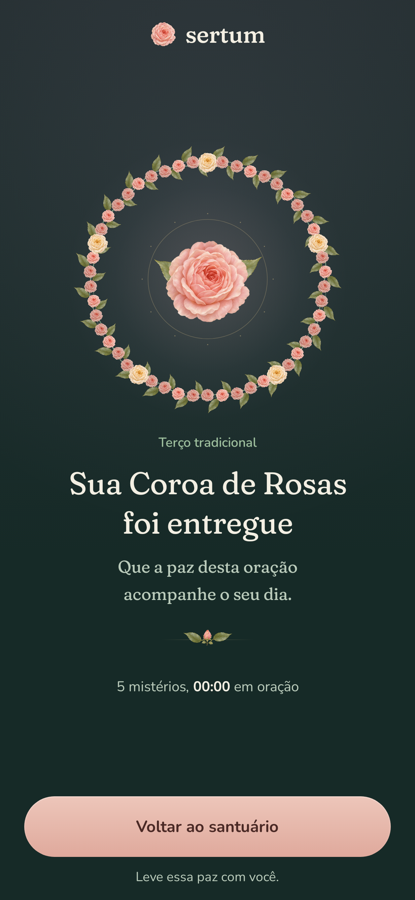</td>
</tr>
</table>


The animation is rendered from the Android Compose UI at controlled frame times. Ambient light and leaf movement stop when system animations are disabled.

</details>

## Phase 2: contemplative mysteries, scripts, and devotional crowns

All ten Roteiros guides can be prayed offline. Each of the twenty rosary mysteries has a Scripture excerpt, a biblical scene, a theological reflection, a daily practice, and ten bead meditations. The three themed rosaries add their own offerings and sixty mystery-specific intentions. The complete traditional script continues through the responsive Litany of Loreto and its closing prayer.

<table>
  <tr>
    <th>Roteiros · every way of praying</th>
    <th>Other crowns · each with its shape</th>
    <th>A crown's sheet · seven of seven</th>
  </tr>
  <tr>
    <td>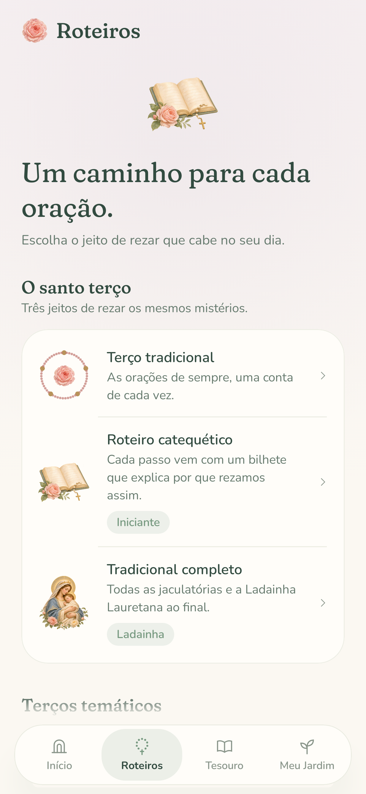</td>
    <td>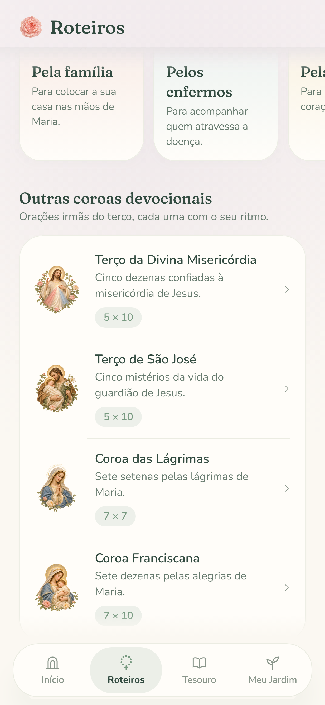</td>
    <td>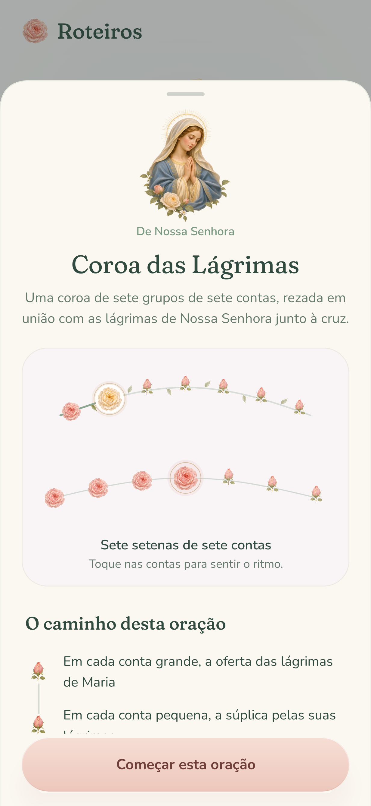</td>
  </tr>
</table>

<table>
  <tr>
    <th>The mystery, layer by layer</th>
    <th>Bead by bead</th>
    <th>Contemplation sheet</th>
  </tr>
  <tr>
    <td>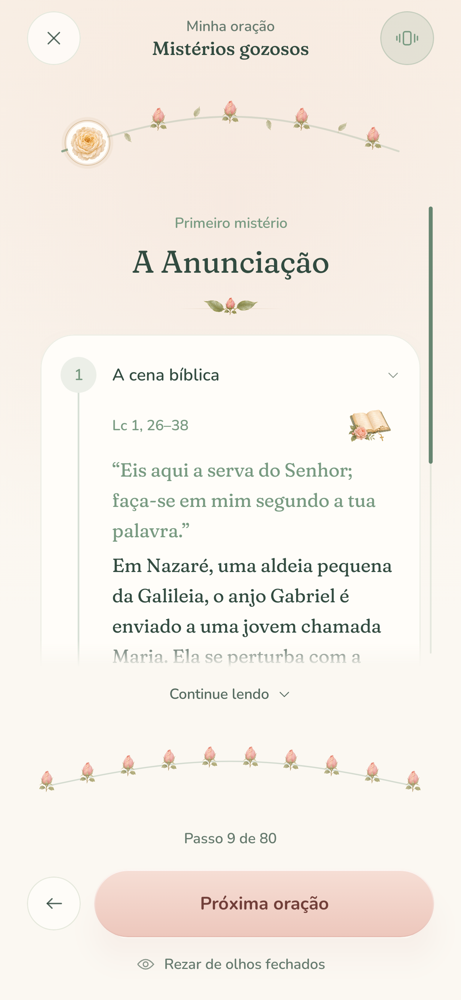</td>
    <td>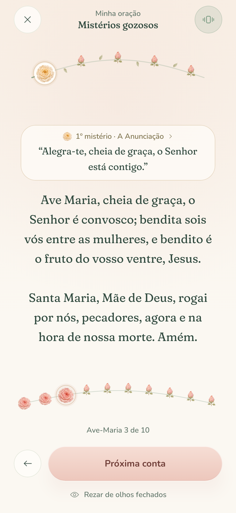</td>
    <td>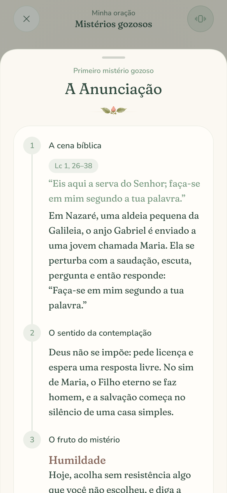</td>
  </tr>
</table>

<details>
<summary><strong>See the catechetical notes, the litany's two voices, Vigil, and the places still in bud</strong></summary>

<table>
<tr><th>Why we pray this way</th><th>Two voices</th><th>Roteiros at dusk</th><th>Tesouro, in bud</th></tr>
<tr>
<td>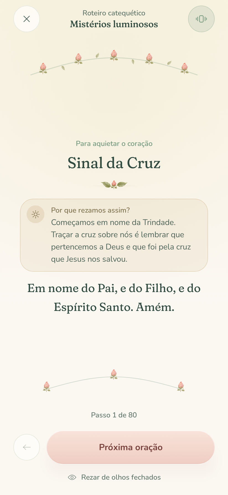</td>
<td>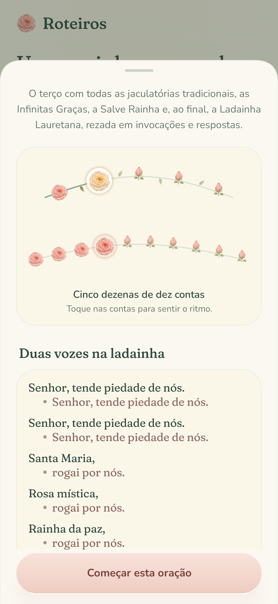</td>
<td>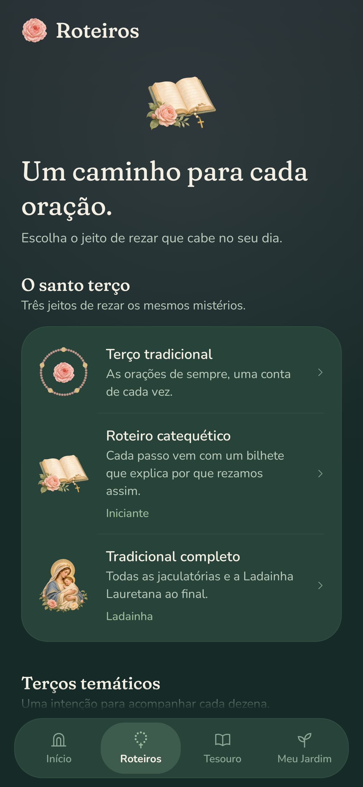</td>
<td>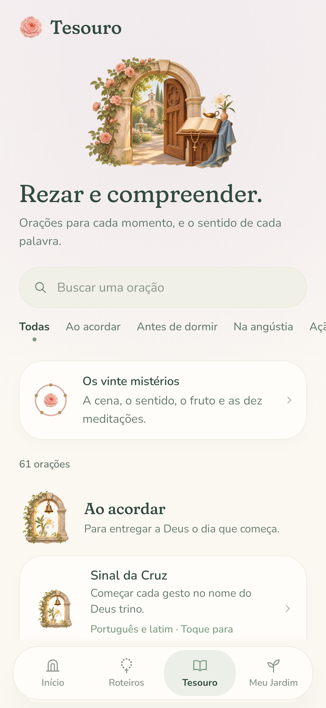</td>
</tr>
</table>

</details>

| Phase 2 capability | Delivered behavior |
| --- | --- |
| Four-place navigation | Início, Roteiros, Tesouro, and Meu Jardim; navigation hides during prayer. Tesouro and Meu Jardim remain the planned Phase 3 and 4 placeholders. |
| Mysteries in four dimensions | Twenty complete contemplations and 200 bead meditations, accessible before and during each rosary decade. |
| Rosary scripts | Traditional, catechetical, complete with all 67 responsive litany invocations, and themed rosaries for family, the sick, and peace. |
| Divine Mercy | Five groups of Eterno Pai and ten Passion invocations, followed by three Deus Santo prayers. |
| Saint Joseph | Five mysteries of his life, with Pai-Nosso, ten invocations, and Glória in each group. |
| Crown of Tears | Seven groups of seven beads, three concluding offerings, and the final Marian prayer. |
| Franciscan Crown | Seven joys with ten Ave-Marias each, followed by two additional Ave-Marias: 72 in total. |
| Session and artwork | Group and bead navigation, tactile feedback, pause/resume, saved-state recovery, and delivered crowns adapt to each script. |

See [Phase 2 implementation and content notes](docs/phase-2.md) for the exact structures and content references.

## A complete rosary

### Arrive, contemplate, pray, and offer

1. **Find a little quiet.** The sanctuary shows today's date and automatically selects the traditional mystery set. Day, Vigil, and System appearance are available from the custom light control.
2. **Choose how to pray.** Start **A sós** (solo, the default) or **Em grupo**, from the sanctuary or any guide sheet. On the sanctuary, the small text choices sit below the mysteries and scroll with the page; a subtle downward chevron reveals more content when touched and disappears at the end. The prayer action stays within reach. Solo prayer uses a personal offering and thanksgiving, including themed intentions. The Our Father, Hail Mary, and other shared traditional prayers keep their familiar wording. Switch between Gozosos, Luminosos, Dolorosos, and Gloriosos; each set includes its five mysteries, Scripture references, and spiritual fruits.
3. **Pray the whole rosary.** Follow every opening prayer, all five decades, and the closing thanksgiving and Salve Rainha. The sequence contains **59 physical beads across 80 prayer and announcement steps**.
4. **Follow the roses.** Beads bloom with a gentle spring animation. Move forward or backward, tap a particular bead, or select a mystery directly from the botanical arc.
5. **Offer the crown.** Fifty flowers surround a central rose. The closing screen shows elapsed prayer time and a peaceful return to the sanctuary.

The traditional opening includes the Sign of the Cross, offering, Apostles' Creed, Our Father, three Hail Marys for faith, hope, and charity, and Glory Be. Each decade includes its mystery announcement, Our Father, ten Hail Marys, Glory Be, and the Fatima prayer. The rosary closes with Infinitas Graças and Salve Rainha.

### Read every line at your own pace

A compact header, curved rose stems, and shared progress/eyes-closed row give most of the screen to reading. The meditation card offers **Cena**, **Sentido**, and **Fruto** on one animated stem. Each section uses a consistent left edge, with no indented text gutter or repeated heading. Long prayers align left; titles and short invocations remain centered. The original text sizes, painted artwork, spring blooms, and ambient garden motion are preserved. The offering and the Cana scene fit on a standard portrait phone without scrolling.

Long prayers show a custom sage position rail, short fades at edges with hidden text, and a **Continue lendo** action beneath the reading area. Tap to read the next portion with overlap, or scroll normally. At the end, **Voltar ao início** returns to the top. Reading never advances the rosary, and prayers that fit have no scroll cues. The labeled **Olhos fechados** switch beside the step counter opens eyes-closed prayer. Changing a meditation section keeps its heading in place and returns the new passage to the top.

<table>
<tr><th>Day reading</th><th>Vigil reading</th></tr>
<tr>
<td>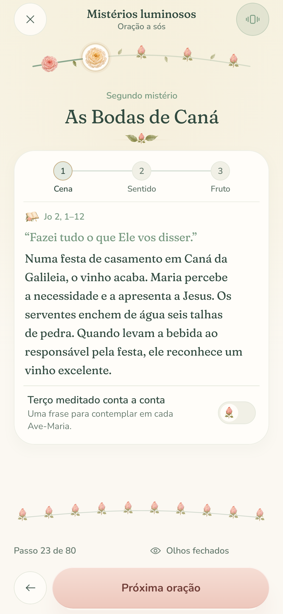</td>
<td>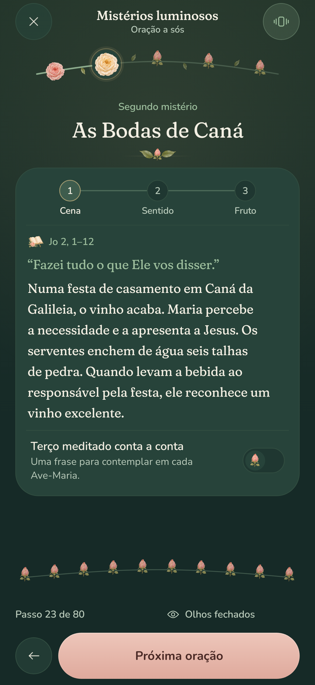</td>
</tr>
</table>

See the [large-text view](docs/screenshots/prayer-reading-large-text.png) and [section transitions and rose bloom](docs/screenshots/prayer-reading-motion.mp4).

<table>
<tr><th>More text below</th><th>End of the text</th></tr>
<tr>
<td>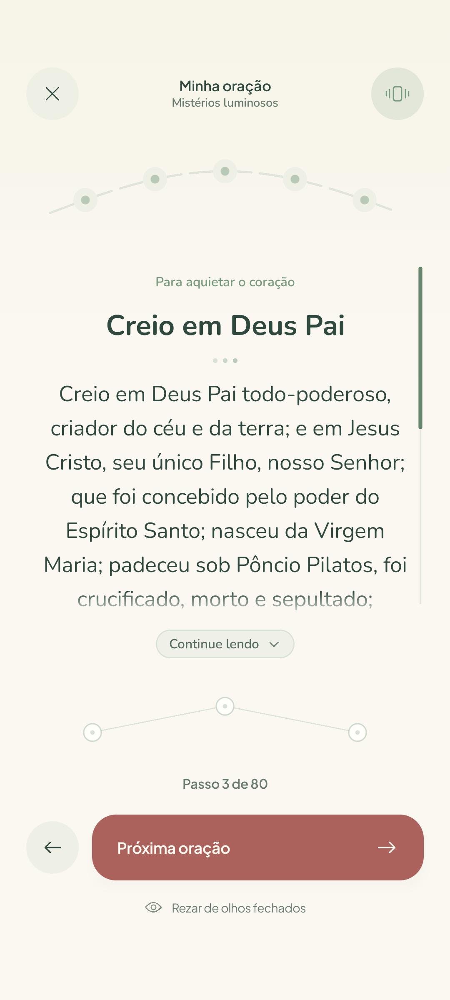</td>
<td>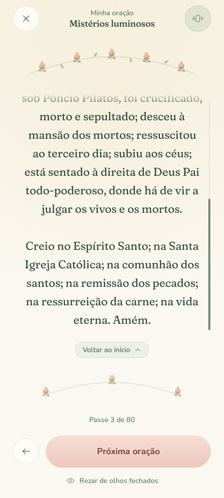</td>
</tr>
</table>

### Pray with your eyes closed

A large tactile surface occupies half the prayer screen. You can keep your attention on prayer while touch guides the sequence.

| Gesture | Action |
| --- | --- |
| Tap | Advance one prayer or bead |
| Swipe left or up | Advance |
| Swipe right | Return to the previous prayer or bead |

Haptics distinguish a small bead, a prayer or decade boundary, and the completed crown with single, double, and triple pulses. Vibration can be disabled. The tactile surface also exposes a screen-reader action.

### Pause and return gently

Returning to the sanctuary keeps the active crown available to continue. `SavedStateHandle` preserves the prayer position, mystery set, prayer mode, appearance selection, and tactile preferences through Android activity and saved-state recreation. Choosing a mode for a new crown keeps the paused crown's original mode; sessions saved before this choice existed retain their group wording. In solo mode, the complete guide invites you to pray both the litany's invocation and response.

Durable history, a persistent preference store, and the intention notebook belong to Phase 4. They are separate from the current session recovery.

## Designed as a quiet garden

The visual system is **O Jardim de Maria**: a comforting place of shelter, with a soft rounded serif, gentle shapes, and an original Marian illustration.

| Element | How it is made |
| --- | --- |
| The garden | Bundled model-generated sacred paintings for day and Vigil: Mary and the Child, a rose-covered arch and stone path, with Canvas light and pollen |
| Living beads | Painted blush and ivory roses, buds that blend into blooms, sage leaves, a growing stem, fine gold selection rings, and gentle spring animations |
| Offered crown | Fifty painted roses woven with sage leaves, five ivory mystery markers, and a central rose in a quiet gold setting |
| Typography | Bundled fixed-weight Fraunces and Nunito instances, with the soft serif axes baked in for consistent rendering across devices |
| Day | Warm cream `#FBF8F2`, sage `#789A81`, rose `#C07A72`, and blush petal actions |
| Vigil | Deep forest `#162A27`, cream `#F3EFE3`, and muted rose `#E0A99C` |
| Controls | Custom Foundation buttons, filled icon controls, press indications, mystery selectors, and appearance menu |
| Atmosphere | Peach, honey, lavender, and soft sky tints tied to the selected mystery set |

**Zero Material or Material3 components.** Both dependency groups are excluded from every configuration, including preview tooling. Colors, typography, spacing, shapes, and mystery atmosphere are provided through custom composition locals.

Read the [full design system](docs/design-system.md) for tokens, interaction rules, and accessibility details.

## Automatic APK releases

Every successful push to `main` creates a [GitHub Release](https://github.com/mariajunqueiramirandas-cpu/Sertum-Rosarum/releases) with an **optimized, signed, installable APK**, its SHA-256 checksum, and source/build metadata. Unit tests, lint, device UI tests, and a launch check of the minified app must pass before publishing.

The included stable fallback signer works without GitHub Secrets. It is an intentionally public development identity; optional private signing secrets override it on main. A different pre-existing signing certificate requires a one-time uninstall before switching to these builds.

Builds use automatic version codes, R8 code and resource shrinking, larger memory budgets, Gradle task caches, and warmed emulator snapshots. The emulator tests the APKs from the build job, so compilation happens once. Obsolete PR runs are canceled; every main run is allowed to finish and release.

See [build performance and releases](docs/build-and-releases.md) for memory budgets, signing, versioning, cache behavior, and the full pipeline.

## Run it locally

### Requirements

- **JDK 17**.
- **Android SDK 35**, including Build Tools and Platform Tools.
- An **Android 13 / API 33 or newer** device or emulator to run the app and instrumented tests.
- `ANDROID_HOME` pointing to your SDK, or an untracked `local.properties` containing `sdk.dir=/path/to/Android/Sdk`.

### Build and install

```bash
git clone https://github.com/mariajunqueiramirandas-cpu/Sertum-Rosarum.git
cd Sertum-Rosarum

# Build the development APK with the included Gradle wrapper.
./gradlew assembleDebug

# Install on a connected Android device or emulator.
adb install -r app/build/outputs/apk/debug/app-debug.apk
```

You can also open the repository root in Android Studio, select JDK 17 for Gradle, sync, and run the `app` configuration. On Windows, use `gradlew.bat`.

The debug APK is written to `app/build/outputs/apk/debug/app-debug.apk`. Build the optimized, fallback-signed APK with `./gradlew assembleRelease`; it appears at `app/build/outputs/apk/release/app-release.apk`. CI uploads **android-test-apks**, **android-release**, and build reports on the [Android CI workflow](https://github.com/mariajunqueiramirandas-cpu/Sertum-Rosarum/actions/workflows/android-ci.yml). Main builds also publish the APK on [GitHub Releases](https://github.com/mariajunqueiramirandas-cpu/Sertum-Rosarum/releases).

## Validation

The JVM suite covers the prayer engine, all ten scripts, complete mystery content, saved-state restoration, solo/group prayer modes, and real Compose activity interactions through Robolectric. Lint reports dependency-version and catalog notices only. The device UI suite covers the rosary, mode selection and restoration, and reading accessibility; run it separately on an Android 13+ device or emulator.

```bash
# Build, verify the prayer engine and session state, and run lint.
./gradlew assembleDebug testDebugUnitTest lintDebug

# Run the complete device UI suite with a connected Android 13+ device.
./gradlew connectedDebugAndroidTest
```

| Coverage | Behavior checked |
| --- | --- |
| Rosary sequence | All mystery sets, weekdays, 59 beads, 80 steps, and the fixed prayer order. |
| Phase 2 domain | All script structures; 20 complete mysteries and 200 meditations; 60 themed intentions; the full responsive litany; 49-bead and 72-Ave-Maria crowns; custom group sizes. |
| Session state | Every script traversed forward and backward; dynamic group and bead jumps; pulses; saved-state recovery beyond step 80; Franciscan final pair; meditation indexing for all 200 beads; independent solo/group selection and recovery, including older sessions. |
| Compose activity | Four tabs, sheets, catechesis, meditations, themed scripts, seventh-setena pause/resume and delivery, Franciscan final pair, litany through its final collect, solo/group prayer with recreation and pause/resume, and mode controls in landscape. |
| Device UI and reading accessibility | Original rosary flow, tactile gestures, rotation, and long-text reading at enlarged font sizes. |

The UI suite also captures all six views shown above. CI collects them in the **compose-ui-results** artifact before removing the test app. For fresh local captures and the same optimized release launch check, follow the [device verification instructions](docs/build-and-releases.md#local-verification); the helper saves screenshots under `app/build/outputs/screenshots`.

[GitHub Actions](.github/workflows/android-ci.yml) builds all three APKs once, runs unit tests and lint, and passes those APKs to an accelerated API 33 emulator. The device job checks the five Compose flows, saves screenshots before removing the test target, and smoke-tests the real minified release. A main-only publishing job then creates the APK release. The release automation also has 14 Python tests covering memory budgets, signing, checksums, versioning, idempotency, and publishing guards.

## Inside the app

The prayer sequence is pure Kotlin. A lifecycle-aware view model exposes immutable state, and Compose renders the garden, prayer, and delivered crown from that state.

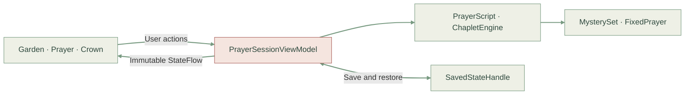

| Layer | Location | Responsibility |
| --- | --- | --- |
| App host | [`MainActivity.kt`](app/src/main/java/com/sertumrosarum/MainActivity.kt), [`SertumApp.kt`](app/src/main/java/com/sertumrosarum/SertumApp.kt) | Edge-to-edge hosting, lifecycle-aware state, route transitions, system bars, and haptic dispatch |
| Prayer domain | [`domain/prayer`](app/src/main/java/com/sertumrosarum/domain/prayer) | Immutable fixed prayers, twenty mysteries, weekday resolution, and deterministic sequence construction |
| Prayer session | [`feature/prayer`](app/src/main/java/com/sertumrosarum/feature/prayer) | State transitions, saved-state recovery, immersive prayer, and crown delivery |
| Sanctuary | [`feature/sanctuary`](app/src/main/java/com/sertumrosarum/feature/sanctuary) | Greeting, garden, mystery controls, appearance, and session continuation |
| Roteiros | [`feature/guides`](app/src/main/java/com/sertumrosarum/feature/guides) | The guide catalogue's interface copy and crown shapes, the three shelves, and each guide's sheet |
| Places in bud | [`feature/treasury`](app/src/main/java/com/sertumrosarum/feature/treasury), [`feature/garden`](app/src/main/java/com/sertumrosarum/feature/garden) | The Tesouro and Meu Jardim tabs, ready for Phases 3 and 4 |
| Design system | [`ui/theme`](app/src/main/java/com/sertumrosarum/ui/theme), [`ui/components`](app/src/main/java/com/sertumrosarum/ui/components) | Custom tokens, fonts, controls, and press feedback |
| Original artwork | [`ui/canvas`](app/src/main/java/com/sertumrosarum/ui/canvas) | Marian garden, roses, living bead arcs, and the completed crown |
| Tactile feedback | [`core/haptics`](app/src/main/java/com/sertumrosarum/core/haptics) | Android `VibratorManager` and differentiated `VibrationEffect` patterns |

### Toolchain

| Component | Version |
| --- | --- |
| Kotlin / Compose compiler plugin | 2.1.20 |
| Compose BOM | 2025.04.00 |
| Android Gradle Plugin | 8.9.1 |
| Gradle wrapper | 8.11.1 |
| Java toolchain | 17 |
| Android | Minimum 33 · Compile / Target 35 |

Versions live in [`gradle/libs.versions.toml`](gradle/libs.versions.toml). The app's package is `com.sertumrosarum`.

## Roadmap

The current app completes **Phases 1 and 2**. Phases 3–5 remain planned.

| Phase | Milestone | Status |
| --- | --- | --- |
| **1** | Garden sanctuary, custom design system, complete rosary counter, living roses, tactile navigation, and crown delivery | **Implemented** |
| **2** | Four-dimensional mysteries, bead-by-bead meditations, prayer scripts, and devotional chaplets | **Implemented** |
| **3** | Prayer treasury, Portuguese / Latin mode, prayer annotations, and a mystery study guide | Planned |
| **4** | Persistent intentions, prayer history, preference storage, and the personal garden | Planned |
| **5** | Lumen catechist and custom rosary supplements with doctrinal guardrails | Planned |

See [`phases.md`](phases.md) for the milestone definitions and acceptance criteria.

## Explore further

| Document | What you will find |
| --- | --- |
| [Build performance and releases](docs/build-and-releases.md) | Automatic signed APKs, memory budgets, caches, versioning, and stable fallback signing |
| [POCO X8 Pro layout](docs/poco-x8-pro.md) | Display research, responsive typography, and device-profile validation |
| [Design system](docs/design-system.md) | The current quiet garden: palette, type, artwork, motion, and accessibility |
| [Product vision](docs/product-vision.md) | The wider experience and long-term product direction |
| [Visão de produto · Português](docs/visao-de-produto-pt.md) | The original Portuguese product vision |
| [Architecture](docs/architecture.md) | The broader architecture blueprint, including later phases |
| [Liturgical content](docs/domain-and-liturgical-content.md) | Domain references, mysteries, prayers, and devotional crown structures |
| [Lumen](docs/lumen-ai.md) | The planned AI catechist, content boundaries, and guardrails |

### Artwork and font credits

The home garden uses original model-generated sacred paintings, inspired by the grace and light of classical Marian art. [Full-resolution garden masters, final prompts, and the seven-round exploration](docs/artwork/garden/README.md) are preserved with the project. The [coordinated botanical paintings and prompts](docs/artwork/botanical/README.md) extend its roses, buds, and leaves through the prayer beads, crown, ornaments, and launcher. Canvas handles composition and motion; interface symbols and the themed launcher use custom vector artwork. Fraunces and Nunito are bundled from Google Fonts under their [SIL Open Font Licenses](docs/fonts).

---

<div align="center">

**Com Maria, um passo de cada vez.**<br />
*Uma oração de cada vez. Sem pressa.*

</div>
