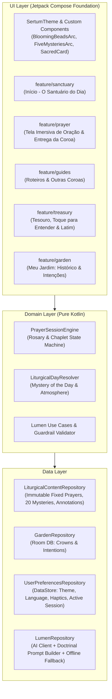
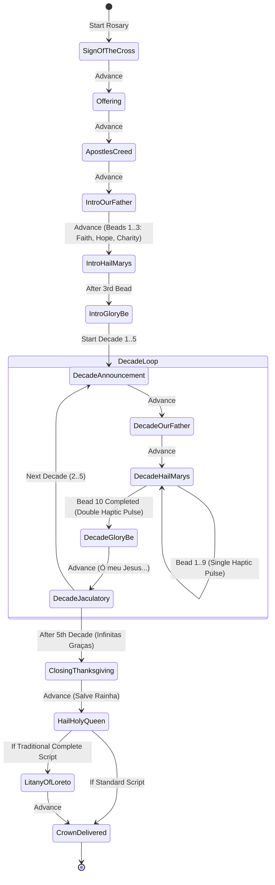

# 🏗️ Technical & Software Architecture

> **Namespace:** `com.sertumrosarum`  
> **Target / Compile SDK:** `35` (Android 15)  
> **Minimum SDK:** `33` (Android 13+)  
> **Language & UI:** Kotlin 2.1 + Jetpack Compose (`ui` + `foundation` only, no Material)

---

## 1. Architectural Principles

1. **Pure Foundation Compose UI**: All visual components, themes, animations, and gestures are implemented directly on `androidx.compose.ui` and `androidx.compose.foundation` using custom `CompositionLocal` tokens (`SertumTheme`).
2. **Offline-First Sacred Core**: All fixed prayers (Portuguese & Latin), the 20 Mysteries in 4 Dimensions, theological term annotations, ready-made Rosary scripts, devotional chaplets, and the user's spiritual journal (`Meu Jardim`) work 100% offline with zero network dependency.
3. **Unidirectional Data Flow (UDF)**: Every screen is driven by a lifecycle-aware `ViewModel` exposing a single immutable `StateFlow<UiState>` and accepting user actions via sealed `UiEvent` / intent methods.
4. **Immutable Liturgical Integrity**: Fixed prayers of the Church are stored in a read-only, checksummed liturgical repository that cannot be mutated by user input or by the **Lumen** AI engine.

---

## 2. High-Level System Architecture



---

## 3. Package Structure

All application code lives under `app/src/main/java/com/sertumrosarum/`:

```text
com.sertumrosarum/
├── MainActivity.kt                  # Edge-to-edge host activity
├── SertumApp.kt                     # Root composable, SertumTheme & Navigation host
├── core/
│   ├── haptics/                     # HapticFeedbackController (Android 13+ VibrationEffect)
│   └── time/                        # Clock & Day-of-week liturgical utilities
├── ui/
│   ├── theme/                       # SertumTheme, SertumColors, SertumTypography, MysteryAtmosphere
│   ├── components/                  # SacredCard, SacredPrimaryButton, SacredBottomSheet, SertumBottomBar
│   ├── canvas/                      # BloomingBeadsArc, FiveMysteriesArc, RoseCrownEmblem
│   └── navigation/                  # SertumNavHost, TopLevelDestination, ScreenRoutes
├── domain/
│   ├── model/                       # MysterySet, Mystery, Prayer, PrayerStep, PrayerScript, Intention
│   ├── engine/                      # RosarySequenceBuilder, ChapletSequenceBuilder, PrayerStateMachine
│   └── lumen/                       # LumenGuardrails, CustomRosarySupplement, MysteryExplanation
├── data/
│   ├── catalog/                     # Immutable Fixed Prayers (PT/LAT), 20 Mysteries 4D, Annotations
│   ├── local/                       # Room Database (SertumDatabase, PrayerSessionDao, IntentionDao)
│   ├── preferences/                 # DataStore (SertumPreferences, ActiveSessionSnapshot)
│   └── lumen/                       # LumenApiService, LumenPromptBuilder, OfflineLumenFallback
└── feature/
    ├── sanctuary/                   # Tab 1: Início (SanctuaryScreen, SanctuaryViewModel)
    ├── guides/                      # Tab 2: Roteiros (GuidesScreen, GuidesViewModel)
    ├── treasury/                    # Tab 3: Tesouro (TreasuryScreen, PrayerDetailSheet, MysteriesStudyScreen)
    ├── garden/                      # Tab 4: Meu Jardim (GardenScreen, IntentionsViewModel)
    └── prayer/                      # Full Screen: ImmersivePrayerScreen, CrownDeliveredScreen, PrayerViewModel
```

---

## 4. Navigation Architecture

Navigation is managed via `androidx.navigation.compose` with two distinct presentation modes:

1. **Sanctuary Shell (4 Bottom Tabs)**:
   * `SanctuaryRoute` (`Início`)
   * `GuidesRoute` (`Roteiros`)
   * `TreasuryRoute` (`Tesouro`)
   * `GardenRoute` (`Meu Jardim`)
   * Switching between top-level tabs preserves state (`saveState = true`, `restoreState = true`, `launchSingleTop = true`).
2. **Full-Screen Immersive Modal Flows (No Bottom Bar)**:
   * `ImmersivePrayerRoute(scriptId, mysterySetId, customSupplementId?)`: Hides the bottom navigation bar and expands edge-to-edge so the user can pray with zero visual distraction.
   * `CrownDeliveredRoute(sessionId)`: Celebratory completion screen displaying the illuminated Crown of Roses and the user's offered intentions before returning to `Início` or `Meu Jardim`.

---

## 5. Prayer Engine & State Machine (`PrayerStateMachine`)

The heart of the application is a deterministic, pure-Kotlin state machine that transforms a `PrayerScript` (plus an optional `MysterySet` and optional `Lumen` supplement) into an ordered, navigable list of `PrayerStep` nodes.



### Step Granularity & Progress Calculation
Each `PrayerStep` carries:
* `stepIndex: Int` and `totalSteps: Int`
* `phase: PrayerPhase` (`INTRODUCTORY`, `DECADE_MYSTERY`, `CLOSING`, `COMPLETED`)
* `decadeIndex: Int?` (`0..4` for the 5 Mysteries, or `0..6` for 7-group chaplets)
* `beadIndexInGroup: Int?` and `groupBeadCount: Int?` (e.g., `0..9` out of `10` for a Rosary decade, or `0..2` out of `3` for introductory Hail Marys)
* `fixedPrayer: FixedPrayer` (immutable Portuguese and Latin text)
* `meditationText: String?` (bead-by-bead meditation or mystery reflection)
* `catecheticalNote: String?` (shown when using the Beginner Catechetical Script)
* `hapticType: HapticPulseType` (`SOFT_BEAD_TICK`, `DECADE_DOUBLE_PULSE`, `CROWN_COMPLETION`)

Because the entire sequence is deterministic and indexed, the user can:
* Advance one bead at a time (`nextStep()`).
* Step backward (`previousStep()`) if they tapped by mistake.
* Tap a specific bead on the `BloomingBeadsArc` (`jumpToBead(index)`).
* Tap a segment on the `FiveMysteriesArc` (`jumpToDecade(decadeIndex)`).
* Persist and restore the exact `stepIndex` across app restarts.

---

## 6. Testing & Continuous Integration Strategy

GitHub Actions (`.github/workflows/android-ci.yml`) runs `./gradlew testDebugUnitTest` and `./gradlew lintDebug` on every push and pull request.

* **Unit Tests (`app/src/test`)**:
  * **Liturgical Calendar & Mystery Resolution**: Verify that Monday/Saturday resolve to *Mistérios Gozosos*, Thursday to *Luminosos*, Tuesday/Friday to *Dolorosos*, and Wednesday/Sunday to *Gloriosos*.
  * **Prayer Engine State Machine**: Verify exact bead counts (59 steps for standard Rosary, 60+ with Litany of Loreto, custom counts for Divine Mercy and Crown of Tears), forward/backward navigation, and haptic trigger assignments.
  * **Lumen Guardrails**: Verify that `LumenGuardrails` rejects or strips any attempt to alter immutable fixed prayer texts.
  * **ViewModel State Tests**: Test `SanctuaryViewModel`, `PrayerViewModel`, `TreasuryViewModel`, and `GardenViewModel` using `kotlinx-coroutines-test`.
* **Compose UI & Instrumentation Tests (`app/src/androidTest`)**:
  * Verify rendering of the Sanctuary screen, starting a Rosary, counting through beads via button and Eyes-Closed touch area, toggling Latin mode, and reaching the `"Sua Coroa de Rosas foi entregue"` completion screen.
