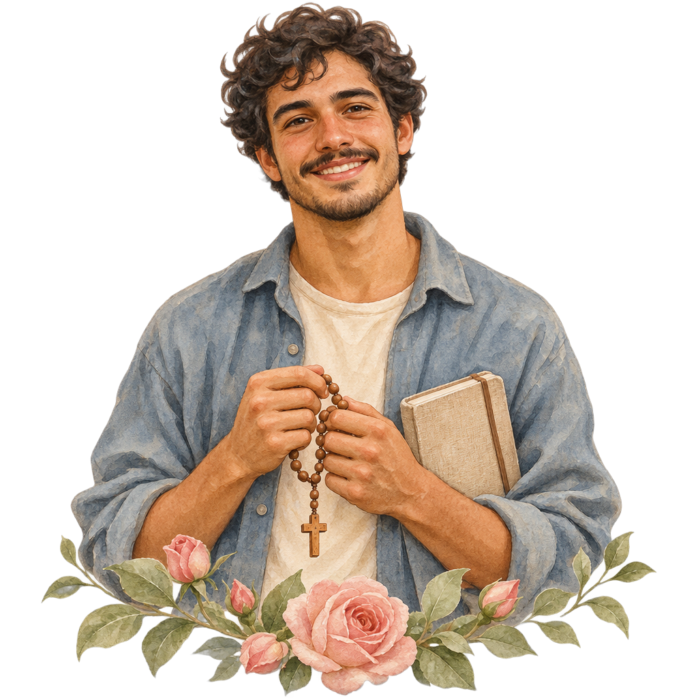
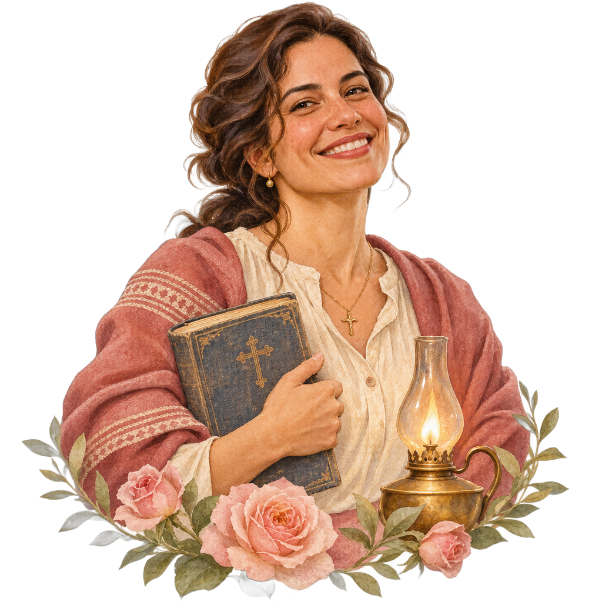
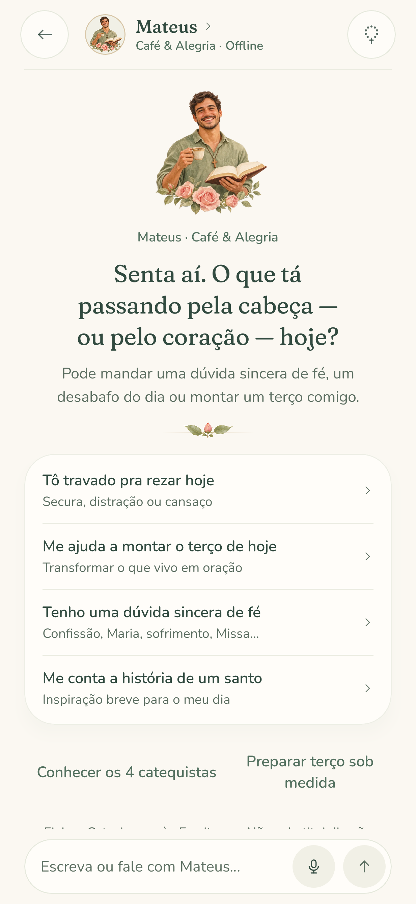
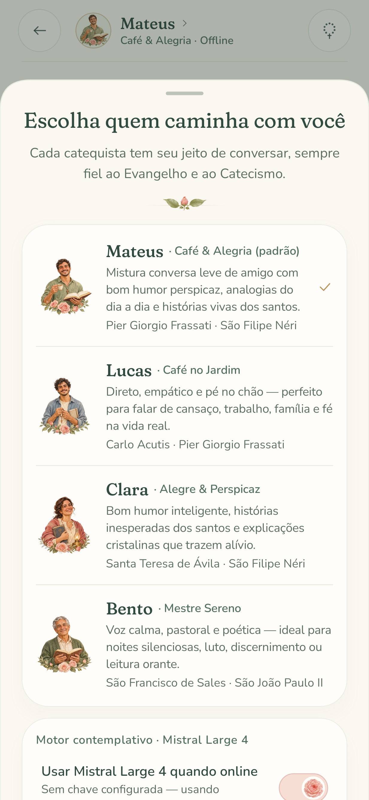
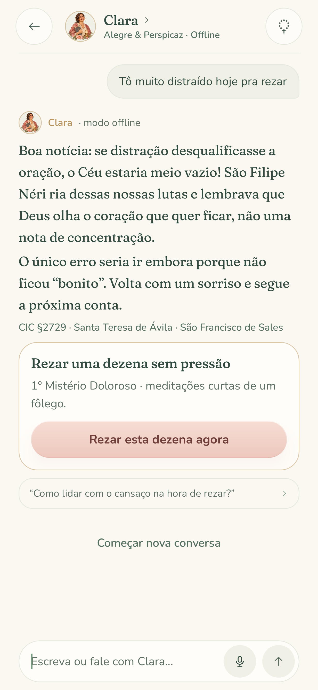

# Four painted portraits for the Catechist companions

These four original transparent watercolor and gouache portraits extend Sertum Rosarum's **O Jardim de Maria** botanical family to the conversational Catholic catechists (**Mateus**, **Lucas**, **Clara**, and **Bento**).

Each portrait was generated with **MeshyAI Text-to-Image** (`/openapi/v1/text-to-image`) using the SOTA **`gpt-image-2-6-sunburst`** model with `remove_background: true` and `aspect_ratio: "1:1"`, preserving transparent alpha margins and matching the palette of [formation-and-garden](../formation-and-garden/README.md). No halos are used, honoring the distinction between lay catechists and canonized saints.

| Mateus (*Café & Alegria · padrão*) | Lucas (*Café no Jardim*) | Clara (*Alegre & Perspicaz*) | Bento (*Mestre Sereno*) |
| --- | --- | --- | --- |
|  |  |  |  |

## Runtime exports

Full 1024 × 1024 RGBA PNG masters stay in [`masters/`](masters/) outside the APK; [prompts.json](prompts.json) records the model, prompts, alpha bounds, SHA-256 checksums, and dimensions. The app bundles 512 × 512 RGBA WebP exports in `app/src/main/res/drawable-nodpi/catechist_*.webp` totaling ~338 KiB across all four companions.

## Native interface previews

Rendered from JVM Compose UI tests (`CatechistFlowTest`):

| Welcome · Mateus | Persona Picker (All 4) | Conversation · Clara |
| --- | --- | --- |
|  |  |  |

