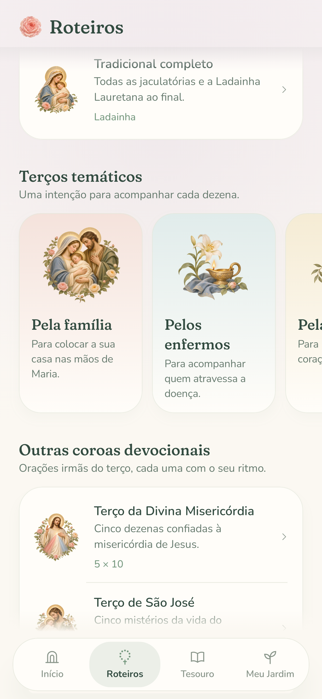
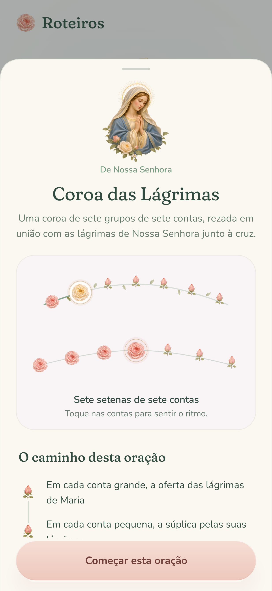
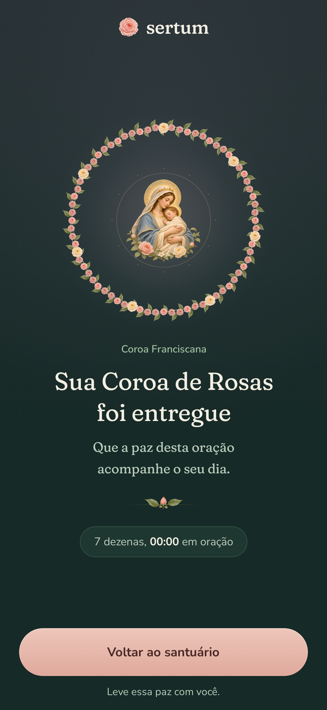

# Sacred paintings for the prayer library

Eight original model-generated paintings extend the approved [Marian garden](../garden/README.md) into Phase 2. The direction draws on Raphael's serene Madonnas and Murillo's warm sacred light: natural faces, dignified gestures, fine gold halos, Marian blue, ivory, blush roses, and sage foliage. The source garden supplied the visual reference; these are newly generated compositions.

| Painting | Use and iconography |
| --- | --- |
| [Prayer book](masters/prayer_book.png) | Roteiros, catechetical notes, Scripture ornaments, and Tesouro; an open book with a rosary and rose. Its pages contain no generated lettering. |
| [Holy Family](masters/holy_family.png) | Family intention; Mary, Joseph, and one infant Jesus, with distinct halos. |
| [Divine Mercy](masters/divine_mercy.png) | Jesus blessing with His right hand, with red and pale rays descending from His heart. |
| [Saint Joseph](masters/saint_joseph.png) | Joseph holding the Child and white lilies; his face follows the Holy Family reference. |
| [Our Lady of Tears](masters/our_lady_of_tears.png) | Mary alone, quietly weeping with joined hands. No swords or pierced heart are added to this devotion. |
| [Consolation](masters/consolation.png) | Intention for the sick; a white lily, oil lamp, folded cloth, and rosebud. |
| [Peace](masters/peace.png) | A white dove carrying an olive branch. |
| [Seven Joys](masters/seven_joys.png) | The Franciscan crown; Mary holding the Child, with a delicate gold circlet and halo. Also accompanies the complete Marian rosary in the library. |

The [exact prompts, generation filenames, and reference relationships](prompts.json) are preserved alongside the unmodified 1254 × 1254 RGBA PNG masters. All silhouettes have true transparency, including the spaces between their leaves.

## Scale and composition

Library rows use 64 dp images; themed cards give the illustration 104 dp of height. Guide sheets use 128 dp portraits. The book at the Roteiros entrance is an 88 dp ornament. Tesouro now has its own [seven-painting collection](../treasury/README.md), while its mystery study sheets retain the Scripture-book ornaments. Every image uses `ContentScale.Fit` with its original transparent margins, keeping halos, hands, lilies, and wings inside the composition. The title beside each decorative image provides its accessible name.

Delivered devotional crowns place the matching painting inside the existing gold setting. Ordinary rosaries retain their central rose. The surrounding flowers use the script's actual counts: 49 for Tears and 72 for the Franciscan crown. Blossom size and leaf spacing contract for denser rings. Sacred figures remain still; only the surrounding light and foliage retain the app's restrained motion, which respects the live system animation setting.

The Scripture book is an ornament beside the biblical citation, not a substitute for an illustration of each mystery's scene. All prayer texts, sequences, intentions, and controls remain the Phase 2 implementation.

## Runtime exports

The eight `devotion_*.webp` files in [drawable-nodpi](../../../app/src/main/res/drawable-nodpi) are 512 × 512, quality 94, retaining alpha. Together they occupy about 624 KiB. Export each master with ImageMagick:

```sh
magick masters/prayer_book.png -resize 512x512 -define webp:method=6 -quality 94 devotion_prayer_book.webp
```

`SertumTheme` supplies a shared lazy cache. Each image is decoded once when first needed and shared between its cards, sheet, and delivered crown. A decoded painting uses approximately 1 MiB; all eight together use at most 8 MiB. The full-resolution masters stay in documentation and are excluded from the APK. All artwork works offline.

## Review previews

These are renders of the actual Android Compose screens using Robolectric native graphics at 411 × 891 dp and 3× density, not device photographs. Reproduce with `./gradlew recordRoborazziDebug`; the screenshot tests cover both appearances, themed cards, guide portraits, delivered crowns, and scrolling header fades.

| Themed intentions | Our Lady of Tears | Franciscan offering |
| --- | --- | --- |
|  |  |  |
