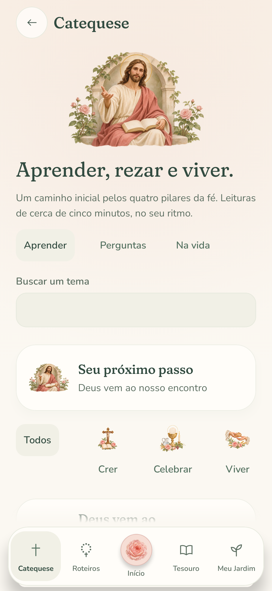
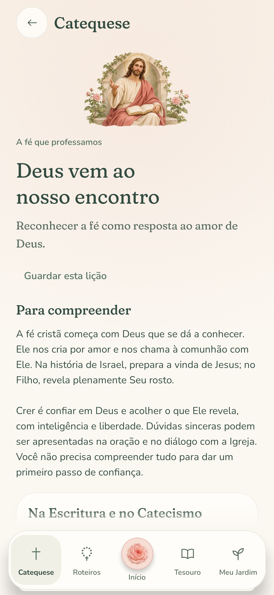
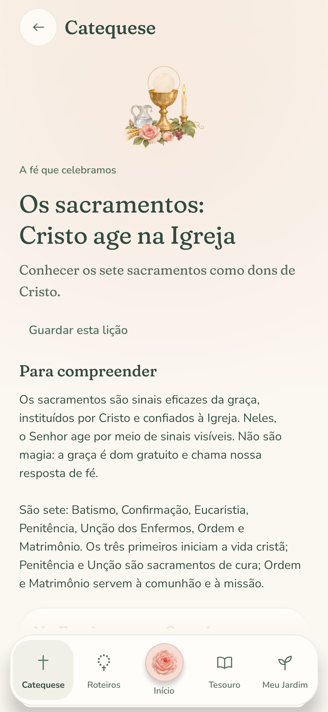
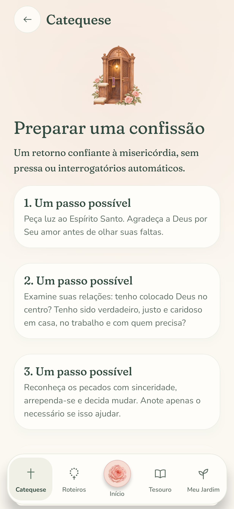

# Twelve paintings for formation and the personal garden

These original model-generated watercolor and gouache paintings extend Sertum's sacred botanical family into Catequese, Início and Meu Jardim. Christ welcomes the learner; a fountain and open gate welcome personal prayer. The four pillars have distinct subjects, while intentions, reflections, saved readings, questions, reconciliation and the liturgical year each receive their own painting.

| Catequese | Meu Jardim | Crer |
| --- | --- | --- |
|  |  |  |

| Celebrar | Viver | Rezar |
| --- | --- | --- |
|  |  |  |

| Intenções | Diário | Guardados |
| --- | --- | --- |
|  |  |  |

| Perguntas | Reconciliação | Ano litúrgico |
| --- | --- | --- |
|  |  |  |

## Placement and behavior

Início's four destination cards use complete paintings above their labels. Its recovery, learning, prayer and intention cards have smaller contextual illustrations. Catequese has a fixed 144 dp opening frame, 44 dp pillar paintings, illustrated lesson/question/journey cards and a 112 dp painting at the beginning of each lesson or practical guide. Search removes the large opening image to bring results into view. Opening a lesson or guide resets its reading position to the top.

Meu Jardim has a compact 112 dp fountain vignette. Its five personal sections, empty states, record cards, intention picker, intention/journal editors and crown details use the corresponding artwork. Crown dates and counts retain their existing dynamic rose rendering. `FormationArtwork.kt` keeps the editorial image mapping outside the domain catalog; all sixteen lessons receive a contextual illustration, with existing Treasury portraits reused where appropriate.

All paintings are decorative, with null content descriptions. Text labels, semantics and actions remain responsible for navigation. They stay still in Day and Vigil and use `ContentScale.Fit`, preserving faces, halos, crosses and margins. No generated words are used as interface text.

## Masters, edits and runtime exports

The twelve final [PNG masters](masters) are preserved at their original generated resolution: two 1536 × 1024 landscapes and ten 1254 × 1254 squares. [prompts.json](prompts.json) records the generator, shared style, subject prompts, edits, source paths, SHA-256 values and runtime dimensions. Two [initial studies](studies) are retained: image-model edits gave the crucifix and sharing-bread compositions complete silhouettes and transparent margins. The final charity painting also removes a distracting gold disc.

The app bundles twelve transparent WebP exports in `drawable-nodpi`: two at 768 × 512 and ten at 512 × 512. They total **1,106,498 bytes (1.06 MiB)**. Their decoded RGBA memory is approximately **13 MiB** if all twelve are visited. The existing shared lazy devotional cache decodes each painting only once, including when the same image appears on multiple cards. Masters and studies stay outside the APK; the app downloads nothing.

Reproduce the proportional exports from the repository root with ImageMagick:

```sh
for subject in catechesis garden; do
  magick "docs/artwork/formation-and-garden/masters/$subject.png" \
    -resize 768x512 -define webp:method=6 -quality 94 \
    "app/src/main/res/drawable-nodpi/formation_$subject.webp"
done
for subject in faith sacraments charity prayer intentions journal bookmarks questions reconciliation liturgical_year; do
  magick "docs/artwork/formation-and-garden/masters/$subject.png" \
    -resize 512x512 -define webp:method=6 -quality 94 \
    "app/src/main/res/drawable-nodpi/formation_$subject.webp"
done
```

## Native interface previews

These are actual Compose renders from Robolectric native graphics. `FormationArtworkFlowTest` opens a lesson from every pillar and all four practical guides, checking their opening paintings, then renders all five personal sections in both themes. `HomeHubTest`, `GardenFormationFlowTest` and `PocoDisplayLayoutTest` cover destination actions, persistence flows, narrow screens and enlarged text.

```sh
./gradlew recordRoborazziDebug --tests '*HomeHubTest' \
  --tests '*GardenFormationFlowTest' --tests '*FormationArtworkFlowTest' \
  --tests '*PocoDisplayLayoutTest'
```

| Início | Catequese | Diário in Vigil |
| --- | --- | --- |
|  |  |  |

| Crer | Celebrar | Preparar uma confissão |
| --- | --- | --- |
|  |  |  |

See [Phase 4](../../phase-4.md) for the learning and personal-continuity behavior.

The artwork change passed all 156 JVM/Compose tests, 15 Treasury tool tests, Android lint, and debug, device-test and release APK builds. The previews use the Android native renderer on the JVM; no physical-device or emulator run is claimed.
