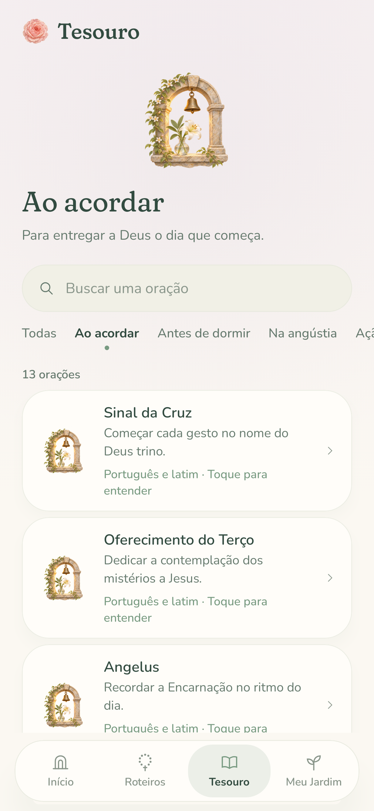
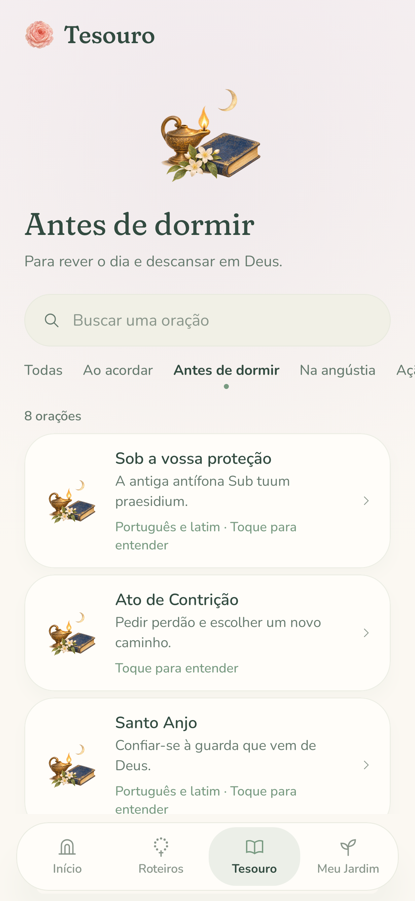
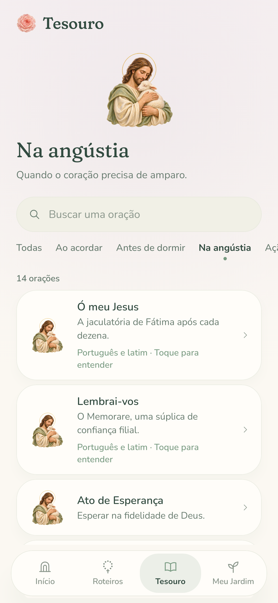
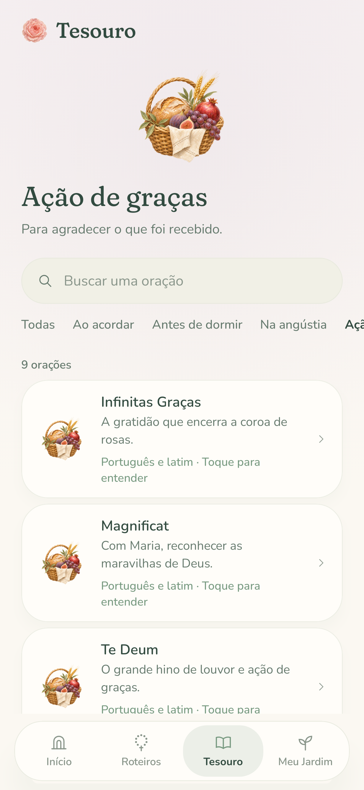
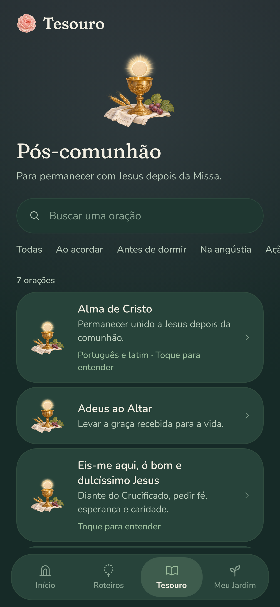
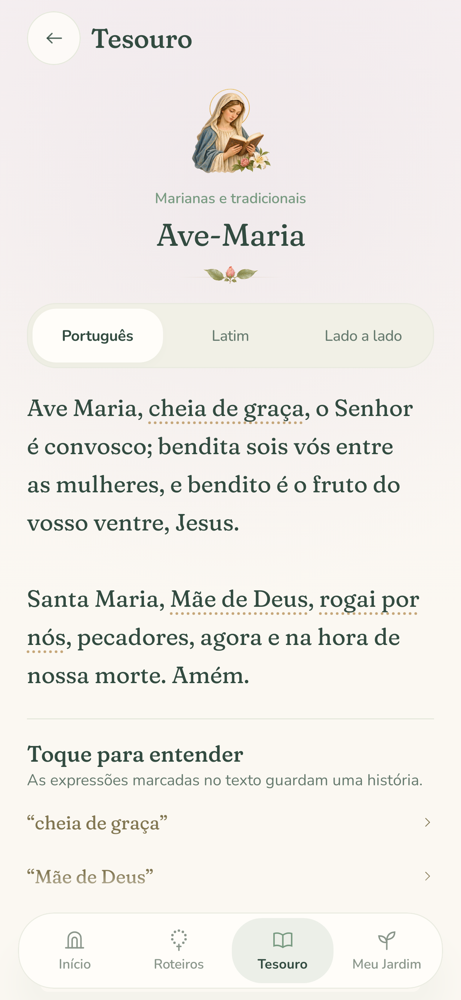

# Seven original paintings for Tesouro

The Treasury has its own coordinated sacred artwork: six paintings for its moments of life and a welcoming chapel-garden entrance. These are original model-generated watercolor and gouache paintings, created for this project. They extend the cream, sage, Marian blue and restrained gold of the existing garden. The concept atlas established the palette; each final category painting was then generated separately with a complete silhouette and real alpha transparency.

| Ao acordar | Antes de dormir | Na angústia |
| --- | --- | --- |
|  |  |  |

| Ação de graças | Pós-comunhão | Marianas e tradicionais |
| --- | --- | --- |
|  |  |  |


## Where the paintings appear

The chapel entrance welcomes the reader to the complete library. Choosing a moment changes the opening illustration and its words. On the full library, each shelf has its own 76 dp painting; prayer cards use the corresponding 56 dp painting, replacing the repeated ivory rose. The reading page carries an 88 dp illustration above its category and title.

During search, the large introductory illustration steps aside so results come into view immediately. The words, category labels and touch targets carry the navigation; paintings are decorative and never replace an accessible name. All images retain their proportions with `ContentScale.Fit`. No face, halo, moon or chalice is cropped. The paintings remain still in both Day and Vigil.

## Masters and generation record

The seven final [PNG masters](masters) remain unmodified at their generated resolution: 1254 × 1254 for each category and 1536 × 1024 for the entrance. The [concept atlas](masters/concept-atlas.png) is also preserved as reference; the app does not crop its illustrations out of the atlas. [prompts.json](prompts.json) records generation prompts, filenames, reference relationships and SHA-256 values.

The iconography is intentionally distinct. The Good Shepherd accompanies consolation; the chalice belongs to communion; the basket expresses thanksgiving. The Marian portrait shows Mary alone reading, rather than repeating the existing mother-and-child pictures. Prayer-book pages and the host contain no generated lettering. The images illustrate a moment of prayer, not a claim to depict the historical setting of every prayer on that shelf.

## Runtime exports

Six transparent 512 × 512 WebP files and one 768 × 512 entrance WebP are bundled in `drawable-nodpi`. Together they add approximately **636 KiB** of image data. The shared devotional cache decodes each painting once on first use, so repeated cards do not allocate repeated bitmaps. Decoding all seven uses about **7.5 MiB**; the full-resolution masters and concept atlas stay outside the APK.

Reproduce the exports with ImageMagick from the repository root:

```sh
for subject in morning night consolation thanksgiving communion marian; do
  magick "docs/artwork/treasury/masters/$subject.png" \
    -resize 512x512 -define webp:method=6 -quality 94 \
    "app/src/main/res/drawable-nodpi/treasury_$subject.webp"
done
magick docs/artwork/treasury/masters/entrance.png \
  -resize 768x512 -define webp:method=6 -quality 94 \
  app/src/main/res/drawable-nodpi/treasury_entrance.webp
```

## Review on the real interface

`TesouroScreenshotTest` renders every category in Day, the night and communion paintings in Vigil, and the reading/glossary on a narrow phone. These are actual Compose renders, not image-generated app mockups.

```sh
./gradlew recordRoborazziDebug --tests 'com.sertumrosarum.screenshots.TesouroScreenshotTest'
```

| Morning | Night | Consolation |
| --- | --- | --- |
|  |  |  |

| Thanksgiving | Communion in Vigil | Reading |
| --- | --- | --- |
|  |  |  |

The [Phase 3 documentation](../../phase-3.md) describes the library, content sources and behavioral tests.
