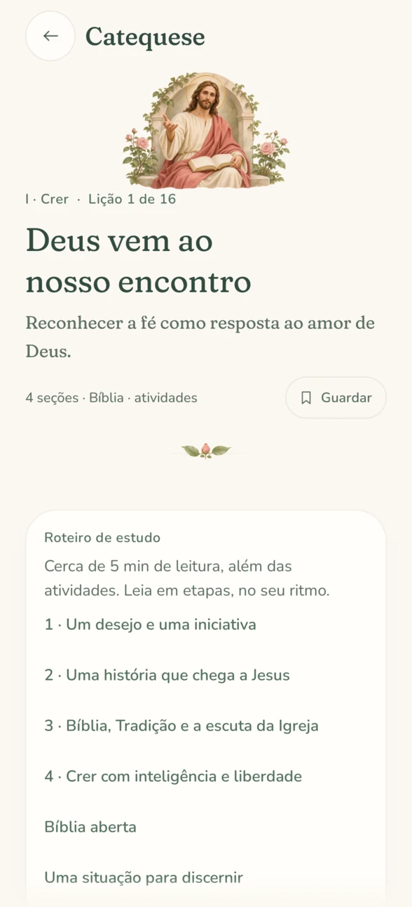
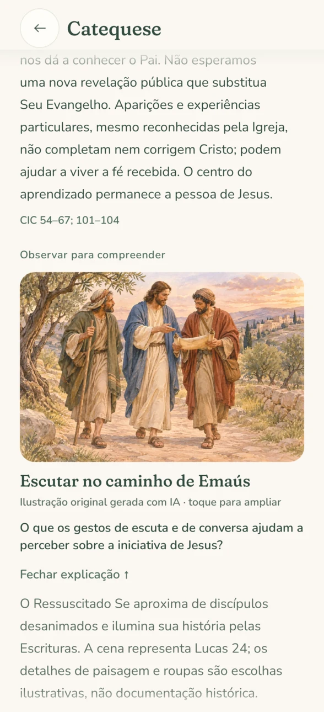
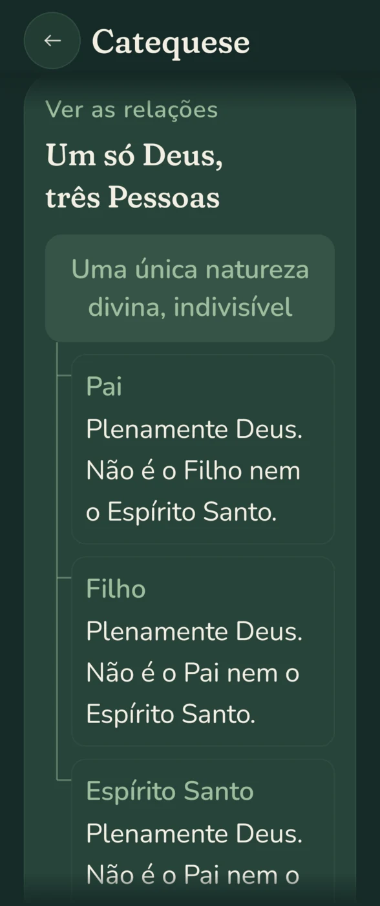

# Catequese: full chapters and visual teaching

Revision 2 · 14 November 2026. Original Brazilian Portuguese editorial content; independent theological review remains pending. The existing sixteen lesson IDs, bookmarks, completion records and reflections remain compatible.

The original two-paragraph lessons now introduce a full study chapter. Each has four developed, source-referenced sections, a guided biblical reading, a practical case with a revealable explanation, three takeaways, three glossary entries and two retrieval questions with revealable answers. The completion assessment has been rewritten as a three-choice applied question, followed by the existing practice, prayer and journal reflection. This adds 64 teaching sections, 16 guided readings, 16 cases, 48 glossary entries and 32 retrieval questions. Scripture summaries are explicitly identified as editorial paraphrases, not quotations.

## Curriculum sequence

| Pillar | Lesson | Expanded scope |
| --- | --- | --- |
| Crer | Deus vem ao nosso encontro | Revelation, salvation history, Jesus as its fullness, Scripture, apostolic Tradition, Magisterium, faith and reason |
| Crer | Trindade | Biblical foundations, nature and Person, limits of analogies, prayer to the Father through Christ in the Spirit |
| Crer | Jesus Cristo | Incarnation, two natures in one Person, Mary as Mother of God, Kingdom, cross, resurrection and Christian hope |
| Crer | Igreja, santos e Maria | People, body and temple; marks of the Church; ministries; communion of saints; Marian doctrines and intercession |
| Celebrar | Sacramentos | Efficacious signs, initiation, catechumenate, healing, anointing, vocation, sacramentals |
| Celebrar | Missa | Gathering, Word, Eucharistic prayer, memorial, preparation, participation, Communion and mission |
| Celebrar | Eucaristia | Institution, real presence, substance and appearances, preparation and fasting, sacramental communion and charity |
| Celebrar | Reconciliação | Mercy, examination, responsibility, contrition, confession, absolution, satisfaction and scruples |
| Viver | Dignidade | Image of God, body and soul, freedom, conscience, commandments, beatitudes, virtues and common good |
| Viver | Graça e liberdade | Sanctifying and actual grace, justification, cooperation, mortal and venial sin, temptation, habits and hope |
| Viver | Misericórdia | Corporal and spiritual works, consent and dignity, prudent service, justice and continuity |
| Viver | Perdão | Feelings and choices, vengeance and justice, reconciliation and trust, protection and repair |
| Rezar | Oração | Christ's prayer, forms and expressions, all seven petitions of the Our Father, distraction, dryness and perseverance |
| Rezar | Rosário | Christ at the center, all twenty mysteries, Scripture and Tradition, the decade, contemplation and fruits |
| Rezar | Ano litúrgico | Sunday and Easter, Advent and Christmas, Lent and Triduum, Easter and Pentecost, both periods of Ordinary Time and colors |
| Rezar | Ritmo diário | A realistic commitment, offering and pauses, examination, community, Sunday and the Liturgy of the Hours |

The lesson introductions plus expanded study material total 14,227 whitespace-delimited words (851–920 per chapter), compared with 1,275 words in the former teaching paragraphs. This count includes the new Scripture studies, cases, glossary and retrieval explanations, and excludes visual captions, concept maps, completion assessments, prayers and personal notes.

Sources live beside the section they support. Additional support includes *Rosarium Virginis Mariae* 19–23, 29–35 and 40–43, and Code of Canon Law canons 916 and 919. This remains a foundational course, not an exhaustive replacement for the Catechism or parish sacramental preparation. No theological reviewer or ecclesial approval has been invented.

## The role of each visual

Every lesson has an accessible concept map. Sequences use numbers and connecting lines; grouped relationships share a single root without suggesting stages. All labels are native text and wrap with the device font size. The Trinity map explicitly rejects division into parts, successive disguises and three gods. The Incarnation map keeps one Person and two complete natures. The Eucharist map distinguishes substance from appearances without pretending to depict a chemical reaction. The liturgical sequence includes both periods of Ordinary Time.

Four [original generated teaching illustrations](artwork/catechism/README.md) show Emmaus, baptismal signs, mercy as food and companionship, and prayer across an ordinary day. Each has a meaningful image description, an observation question, a revealable interpretation, an explicit AI provenance caption and a full-screen view with zoom and pan. All four practical journeys also use their corresponding map; the mercy and evening journeys reuse their relevant teaching illustrations. Decorative opening vignettes continue to have null descriptions so readers do not hear redundant navigation art.

Six historical paintings are retained within relevant biblical studies: Jesus, the communion of the Church, reconciliation, forgiveness, prayer and the rosary. Each has a specific observation prompt, interpretive limits and the existing museum credit and viewer. The rosary painting is identified as a historical fifteen-mystery composition, preceding the luminous mysteries. The other ten paintings remain available in the art credits rather than appearing automatically in every lesson.

The four generated WebPs are bundled, so no network or Internet permission is needed. Full-resolution PNG masters and the provenance manifest stay in documentation, outside the APK. No doctrinal text is embedded in generated pixels.

## Reader and verification

The contents list jumps to any teaching section, biblical study, case or review. Each later section offers a return to the contents. Explanations can be opened and closed independently. Reading time is calculated from the chapter text; time for reflection and practical activities is additional. Course search includes all the new teaching, glossary, Scripture studies, cases and review answers.

`FormationCatalogTest` checks chapter coverage, substantive length, supporting references, exercises and search of newly introduced concepts. `FormationStudyFlowTest` exercises actual contents navigation, accessible illustration enlargement, explanation reveals, the existing completion gate, bundled image decoding and narrow-screen Vigil rendering at 150% text. Existing Garden, artwork and fine-art flow tests exercise saved learning and both image viewers. Screenshots are native Compose renders from Robolectric, not a claim of physical-device testing.

| Chapter outline | Guided observation | Vigil at 150% text |
| --- | --- | --- |
|  |  |  |

```sh
source /workspace/.setup/activate.sh
./gradlew testDebugUnitTest assembleDebug assembleRelease
./gradlew recordRoborazziDebug --tests '*FormationStudyFlowTest'
```

Verified on 14 November 2026: all 163 JVM/Compose tests passed with no failures or skips; debug, device-test and optimized release APKs built successfully. The release build's vital lint check also passed. The focused native screenshot run passed, including 320 dp width at 150% text in Vigil. No physical-device or emulator execution is claimed.
