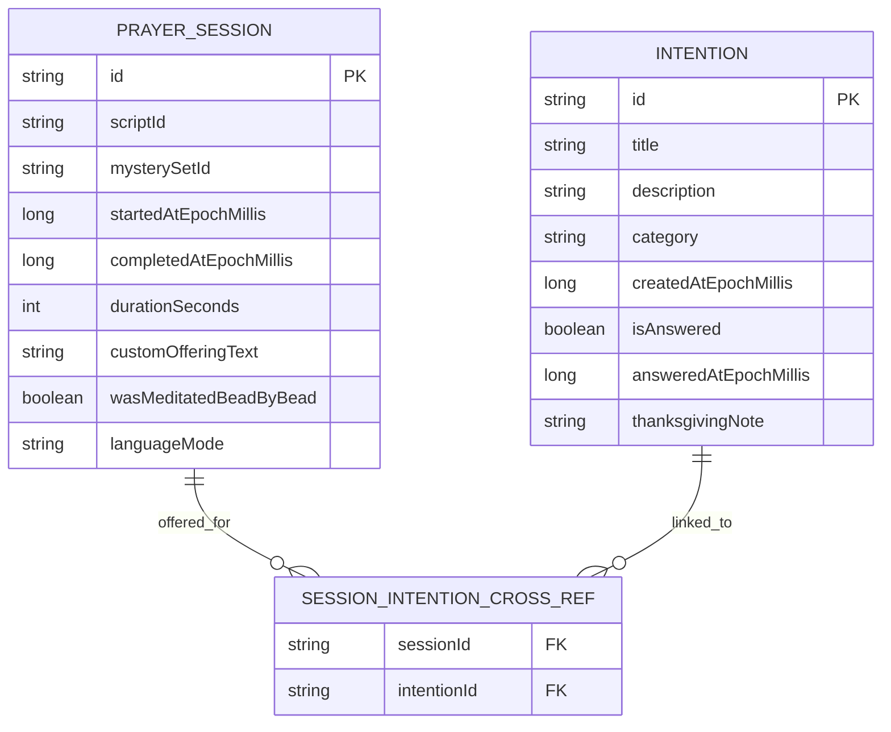

# 📜 Domain Models & Liturgical Content Specification

> This document specifies the core domain models, persistence schema, immutable liturgical texts (Portuguese & Latin), the 20 Mysteries of the Rosary in 4 Dimensions, theological glossary annotations (*"Toque para Entender"*), and devotional crown structures.

---

## 1. Core Domain Models (`domain/model`)

```kotlin
enum class MysterySet(
    val id: String,
    val titlePt: String,
    val subtitlePt: String,
    val defaultDaysOfWeek: Set< java.time.DayOfWeek >
) {
    JOYFUL(
        id = "joyful",
        titlePt = "Mistérios Gozosos",
        subtitlePt = "A Alegria da Encarnação",
        defaultDaysOfWeek = setOf(DayOfWeek.MONDAY, DayOfWeek.SATURDAY)
    ),
    LUMINOUS(
        id = "luminous",
        titlePt = "Mistérios Luminosos",
        subtitlePt = "A Luz da Vida Pública de Cristo",
        defaultDaysOfWeek = setOf(DayOfWeek.THURSDAY)
    ),
    SORROWFUL(
        id = "sorrowful",
        titlePt = "Mistérios Dolorosos",
        subtitlePt = "A Paixão e o Sacrifício Redentor",
        defaultDaysOfWeek = setOf(DayOfWeek.TUESDAY, DayOfWeek.FRIDAY)
    ),
    GLORIOUS(
        id = "glorious",
        titlePt = "Mistérios Gloriosos",
        subtitlePt = "A Ressurreição e a Glória Eterna",
        defaultDaysOfWeek = setOf(DayOfWeek.WEDNESDAY, DayOfWeek.SUNDAY)
    )
}
```

### 1.1 The 4-Dimensional Mystery Model (`Mystery`)
Each of the 20 Mysteries is represented with all 4 contemplative dimensions:

```kotlin
data class Mystery(
    val id: String,
    val set: MysterySet,
    val number: Int,                          // 1..5
    val titlePt: String,                      // e.g., "A Anunciação do Anjo a Nossa Senhora"
    val titleLatin: String,                   // e.g., "Annuntiatio Beatae Mariae Virginis"
    val scriptureReference: String,           // e.g., "Lucas 1, 26-38"
    val scriptureQuotePt: String,             // Key Gospel verse
    // Dimension 1: A Cena Bíblica (Narrative & historical/sensory context)
    val biblicalSceneNarrative: String,
    // Dimension 2: O Sentido da Contemplação (Accessible theological meaning)
    val contemplativeMeaning: String,
    // Dimension 3: O Fruto do Mistério (Virtue + practical attitude for the day)
    val spiritualFruitName: String,           // e.g., "Humildade e Docilidade à Vontade de Deus"
    val spiritualFruitPractice: String,       // Concrete daily resolution
    // Dimension 4: Terço Meditado Conta a Conta (10 contemplative phrases, 1 per Ave-Maria)
    val beadMeditations: List<String>         // Exactly 10 items
)
```

### 1.2 Immutable Fixed Prayer Model (`FixedPrayer`)
Fixed prayers are stored in a read-only catalog (`ImmutablePrayerCatalog`) and can never be modified by AI or user edits:

```kotlin
data class FixedPrayer(
    val id: FixedPrayerId,
    val titlePt: String,
    val titleLatin: String?,
    val category: PrayerCategory,
    val textPt: String,
    val textLatin: String?,
    val alignmentPairs: List<BilingualVersePair> = emptyList(),
    val annotations: List<PrayerTermAnnotation> = emptyList()
)

data class BilingualVersePair(
    val portugueseVerse: String,
    val latinVerse: String,
    val literalExplanationPt: String
)

data class PrayerTermAnnotation(
    val termInText: String,                   // Exact substring highlighted in textPt or textLatin
    val title: String,
    val biblicalAndHistoricalMeaning: String,
    val catechismReference: String? = null
)
```

---

## 2. The 20 Mysteries of the Rosary (Reference Catalog)

### 2.1 Mistérios Gozosos (Monday & Saturday — Amber & Soft Gold)
| # | Mystery (`Mistério`) | Scripture | Fruit of the Mystery (`Fruto`) |
| :-: | :--- | :--- | :--- |
| **1º** | **A Anunciação do Anjo a Nossa Senhora** | `Lc 1, 26-38` | *Humildade* (Acolher os planos de Deus sem resistência) |
| **2º** | **A Visitação de Nossa Senhora a Santa Isabel** | `Lc 1, 39-45` | *Caridade fraterna e amor ao próximo* (Servir com prontidão) |
| **3º** | **O Nascimento de Jesus em Belém** | `Lc 2, 1-7` | *Desprendimento e pobreza de espírito* (Reconhecer Deus no simples) |
| **4º** | **A Apresentação do Menino Jesus no Templo** | `Lc 2, 22-35` | *Pureza e obediência* (Consagrar o trabalho e a família ao Senhor) |
| **5º** | **O Encontro do Menino Jesus no Templo** | `Lc 2, 41-52` | *Busca ardente de Deus em todas as coisas* (Colocar Cristo no centro) |

### 2.2 Mistérios Luminosos (Thursday — Solar Gold & White)
| # | Mystery (`Mistério`) | Scripture | Fruit of the Mystery (`Fruto`) |
| :-: | :--- | :--- | :--- |
| **1º** | **O Batismo de Jesus no Rio Jordão** | `Mt 3, 13-17` | *Fidelidade às promessas do Batismo* (Viver como filhos amados do Pai) |
| **2º** | **A Autorrevelação de Jesus nas Bodas de Caná** | `Jo 2, 1-11` | *Confiança na intercessão de Maria* ("Fazei tudo o que Ele vos disser") |
| **3º** | **O Anúncio do Reino de Deus e o Convite à Conversão** | `Mc 1, 14-15` | *Conversão do coração e perdão* (Abrir-se à misericórdia divina) |
| **4º** | **A Transfiguração de Jesus no Monte Tabor** | `Lc 9, 28-36` | *Desejo de santidade e oração contemplativa* (Deixar-se iluminar por Cristo) |
| **5º** | **A Instituição da Santíssima Eucaristia** | `Lc 22, 14-20` | *Amor e adoração à Eucaristia* (Fazer da vida uma oferta de amor) |

### 2.3 Mistérios Dolorosos (Tuesday & Friday — Deep Violet & Wine)
| # | Mystery (`Mistério`) | Scripture | Fruit of the Mystery (`Fruto`) |
| :-: | :--- | :--- | :--- |
| **1º** | **A Agonia de Jesus no Horto das Oliveiras** | `Lc 22, 39-46` | *Contrição dos pecados e conformidade com a vontade do Pai* |
| **2º** | **A Flagelação de Nosso Senhor Jesus Cristo** | `Jo 19, 1` | *Mortificação dos sentidos e pureza do corpo e da alma* |
| **3º** | **A Coroação de Espinhos** | `Mt 27, 27-31` | *Cura do orgulho e coragem moral diante das humilhações* |
| **4º** | **Jesus Carrega a Cruz a Caminho do Calvário** | `Lc 23, 26-32` | *Paciência e fortaleza nas provações diárias* |
| **5º** | **A Crucificação e Morte de Nosso Senhor Jesus Cristo** | `Lc 23, 33-46` | *Perdão das ofensas e entrega total pela salvação das almas* |

### 2.4 Mistérios Gloriosos (Wednesday & Sunday — Celestial Blue & Gold)
| # | Mystery (`Mistério`) | Scripture | Fruit of the Mystery (`Fruto`) |
| :-: | :--- | :--- | :--- |
| **1º** | **A Ressurreição de Nosso Senhor Jesus Cristo** | `Lc 24, 1-8` | *Fé viva e alegria pascal* (Caminhar como ressuscitados na esperança) |
| **2º** | **A Ascensão de Jesus ao Céu** | `At 1, 9-11` | *Esperança cristã e desejo do Céu* (Olhar para o alto sem descuidar da missão) |
| **3º** | **A Vinda do Espírito Santo sobre Nossa Senhora e os Apóstolos** | `At 2, 1-4` | *Sabedoria, zelo apostólico e docilidade ao Espírito Santo* |
| **4º** | **A Assunção de Nossa Senhora ao Céu** | `Ap 12, 1` | *Graça de uma santa morte e devoção filial a Maria* |
| **5º** | **A Coroação de Nossa Senhora como Rainha do Céu e da Terra** | `Ap 12, 1-5` | *Perseverança final e confiança no auxílio maternal de Maria* |

---

## 3. Immutable Fixed Prayers (Portuguese & Latin Core)

Below are the canonical texts enforced by `ImmutablePrayerCatalog`:

### 3.1 Sinal da Cruz (`Signum Crucis`)
* **Português:** *Pelo sinal da Santa Cruz, livrai-nos, Deus, Nosso Senhor, dos nossos inimigos. Em nome do Pai e do Filho e do Espírito Santo. Amém.*
* **Latim:** *Per signum Sanctae Crucis, de inimicis nostris, libera nos, Deus noster. In nomine Patris, et Filii, et Spiritus Sancti. Amen.*

### 3.2 Credo Apostólico (`Symbolum Apostolorum`)
* **Português:** *Creio em Deus Pai Todo-Poderoso, Criador do céu e da terra; e em Jesus Cristo, um só seu Filho, Nosso Senhor; o qual foi concebido pelo poder do Espírito Santo; nasceu da Virgem Maria, padeceu sob Pôncio Pilatos, foi crucificado, morto e sepultado; desceu à mansão dos mortos; ressuscitou ao terceiro dia; subiu aos céus, está sentado à direita de Deus Pai Todo-Poderoso, donde há de vir a julgar os vivos e os mortos. Creio no Espírito Santo, na Santa Igreja Católica, na comunhão dos santos, na remissão dos pecados, na ressurreição da carne, na vida eterna. Amém.*
* **Latim:** *Credo in Deum Patrem omnipotentem, Creatorem caeli et terrae. Et in Iesum Christum, Filium eius unicum, Dominum nostrum, qui conceptus est de Spiritu Sancto, natus ex Maria Virgine, passus sub Pontio Pilato, crucifixus, mortuus, et sepultus, descendit ad inferos, tertia die resurrexit a mortuis, ascendit ad caelos, sedet ad dexteram Dei Patris omnipotentis, inde venturus est iudicare vivos et mortuos. Credo in Spiritum Sanctum, sanctam Ecclesiam catholicam, sanctorum communionem, remissionem peccatorum, carnis resurrectionem, vitam aeternam. Amen.*

### 3.3 Pai-Nosso (`Pater Noster`)
* **Português:** *Pai-Nosso que estais nos céus, santificado seja o vosso nome; venha a nós o vosso reino; seja feita a vossa vontade, assim na terra como no céu. O pão nosso de cada dia nos dai hoje; perdoai-nos as nossas ofensas, assim como nós perdoamos a quem nos tem ofendido; e não nos deixeis cair em tentação, mas livrai-nos do mal. Amém.*
* **Latim:** *Pater noster, qui es in caelis, sanctificetur nomen tuum. Adveniat regnum tuum. Fiat voluntas tua, sicut in caelo et in terra. Panem nostrum cotidianum da nobis hodie, et dimitte nobis debita nostra sicut et nos dimittimus debitoribus nostris. Et ne nos inducas in tentationem, sed libera nos a malo. Amen.*

### 3.4 Ave-Maria (`Ave Maria`)
* **Português:** *Ave-Maria, cheia de graça, o Senhor é convosco, bendita sois vós entre as mulheres e bendito é o fruto do vosso ventre, Jesus. Santa Maria, Mãe de Deus, rogai por nós, pecadores, agora e na hora de nossa morte. Amém.*
* **Latim:** *Ave Maria, gratia plena, Dominus tecum. Benedicta tu in mulieribus, et benedictus fructus ventris tui, Iesus. Sancta Maria, Mater Dei, ora pro nobis peccatoribus, nunc et in hora mortis nostrae. Amen.*

### 3.5 Glória ao Pai (`Gloria Patri`)
* **Português:** *Glória ao Pai, e ao Filho e ao Espírito Santo. Como era no princípio, agora e sempre. Amém.*
* **Latim:** *Gloria Patri, et Filio, et Spiritui Sancto. Sicut erat in principio, et nunc, et semper, et in saecula saeculorum. Amen.*

### 3.6 Jaculatória de Fátima (`Oratio Fatimae`)
* **Português:** *Ó meu Jesus, perdoai-nos, livrai-nos do fogo do inferno, levai as almas todas para o céu e socorrei principalmente as que mais precisarem.*
* **Latim:** *Domine Iesu, dimitte nobis debita nostra, salva nos ab igne inferiori, perduc in caelum omnes animas, praesertim eas quae misericordiae tuae maxime indigent.*

### 3.7 Salve Rainha (`Salve Regina`)
* **Português:** *Salve, Rainha, Mãe de misericórdia, vida, doçura e esperança nossa, salve! A vós bradamos, os degredados filhos de Eva; a vós suspiramos, gemendo e chorando neste vale de lágrimas. Eia, pois, advogada nossa, esses vossos olhos misericordiosos a nós volvei; e depois deste desterro, mostrai-nos Jesus, bendito fruto do vosso ventre, ó clemente, ó piedosa, ó doce sempre Virgem Maria. Rogai por nós, Santa Mãe de Deus, para que sejamos dignos das promessas de Cristo. Amém.*
* **Latim:** *Salve, Regina, Mater misericordiae, vita, dulcedo, et spes nostra, salve. Ad te clamamus, exsules filii Hevae. Ad te suspiramus, gementes et flentes in hac lacrimarum valle. Eia, ergo, advocata nostra, illos tuos misericordes oculos ad nos converte. Et Iesum, benedictum fructum ventris tui, nobis post hoc exsilium ostende. O clemens, O pia, O dulcis Virgo Maria. Ora pro nobis, sancta Dei Genetrix, ut digni efficiamur promissionibus Christi. Amen.*

---

## 4. "Touch to Understand" (`Anatomia da Oração`) Sample Glossary

| Prayer | Highlighted Expression | Theological & Historical Explanation (`Bottom Sheet`) |
| :--- | :--- | :--- |
| **Salve Rainha** | *"Degredados filhos de Eva"* | *Degredado* means exiled from one's homeland. In Christian theology, our true homeland is Heaven; during earthly life, we walk as pilgrims yearning for the fullness of communion with God (`CIC §1024`). |
| **Salve Rainha** | *"Vale de lágrimas"* | Echoes Psalm 84:6 (*"Vale de Baca"*). It does not mean a pessimistic rejection of earthly joy, but an honest recognition that human life carries suffering that only Christ's grace can transform into springs of living water. |
| **Salve Rainha** | *"Eia, pois, advogada nossa"* | *Eia* is a classical Latin/Portuguese interjection of confident encouragement ("Come then!"). *Advogada* (*Advocata*, Greek *Parakletos*) means one who is called to stand beside the accused to intercede before the King—as Queen Mother (Gebirah) in the Davidic kingdom (`1 Rs 2, 19`). |
| **Credo** | *"Desceu à mansão dos mortos"* | Refers to the *Sheol* / Limbo of the Just. After His death on the Cross, Christ's soul united to His divine person descended to the realm of the dead to proclaim salvation and open Heaven's gates to the righteous who had gone before Him (`CIC §632-635`). |
| **Credo** | *"Comunhão dos santos"* | Signifies the spiritual solidarity binding together the faithful on earth (*Igreja Militante*), the souls being purified in Purgatory (*Igreja Padecente*), and the blessed in Heaven (*Igreja Triunfante*) in one Body of Christ (`CIC §946-962`). |
| **Anima Christi** | *"Dentro de vossas chagas, escondei-me"* | A medieval contemplative image (popularized by St. Bernard and St. Ignatius of Loyola) seeing the pierced Side and Wounds of the Risen Christ as a cleft in the rock (`Ct 2, 14`) where the soul finds refuge from temptation. |

---

## 5. Devotional Crowns & Chaplet Specifications (`Aba Roteiros`)

| Script / Crown ID | Name | Structure & Bead Mechanics |
| :--- | :--- | :--- |
| `rosary_standard` | **Santo Terço Tradicional** | Crucifix (*Sinal da Cruz, Oferecimento, Credo*) → 1 *Pai-Nosso* + 3 *Ave-Marias* + *Glória* → 5 Decades (1 *Pai-Nosso* + 10 *Ave-Marias* + *Glória* + *Ó meu Jesus*) → *Infinitas Graças* + *Salve Rainha*. |
| `rosary_beginner` | **Roteiro Catequético (Iniciante)** | Same 5-decade structure, enriched with inline catechetical explanation cards before each transition explaining the spiritual meaning of the step. |
| `rosary_complete_loreto` | **Terço Completo com Ladainha Lauretana** | Full 5-decade Rosary followed by the complete **Ladainha de Nossa Senhora (Litany of Loreto)** and closing prayer *Concedei, nós vos pedimos*. |
| `chaplet_divine_mercy` | **Terço da Divina Misericórdia** | Opening (*Pai-Nosso, Ave-Maria, Credo*) → 5 Decades: Large Bead (*"Eterno Pai, eu Vos ofereço o Corpo e o Sangue..."*) + 10 Small Beads (*"Pela Sua dolorosa Paixão, tende misericórdia de nós e do mundo inteiro"*) → Closing 3x (*"Deus Santo, Deus Forte, Deus Imortal..."*). |
| `chaplet_st_joseph` | **Terço de São José** | 5 Mysteries of St. Joseph's life → Large Bead (*Pai-Nosso* / invocation) + 10 Small Beads (*"São José, valei-nos!"* / *"Salve, José, cheio de graça..."*) + *Glória*. |
| `chaplet_crown_of_tears` | **Coroa das Lágrimas de Nossa Senhora** | **7 Septets** (7 groups of **7 beads** instead of 5 groups of 10). Large Bead (*"Vede, ó Jesus, que são as lágrimas..."*) + 7 Small Beads (*"Meu Jesus, ouvi os nossos rogos, pelas Lágrimas de Vossa Mãe Santíssima"*) → 3x Closing invocation. |
| `chaplet_franciscan` | **Coroa Franciscana (7 Alegrias)** | **7 Decades** contemplating the 7 Joys of Our Lady (Annunciation, Visitation, Nativity, Adoration of the Magi, Finding in the Temple, Resurrection, Assumption/Coronation) + 2 extra *Ave-Marias* totaling 72 *Ave-Marias* in honor of Our Lady's earthly years. |

---

## 6. Local Database Schema (`Room` — Phase 4)


