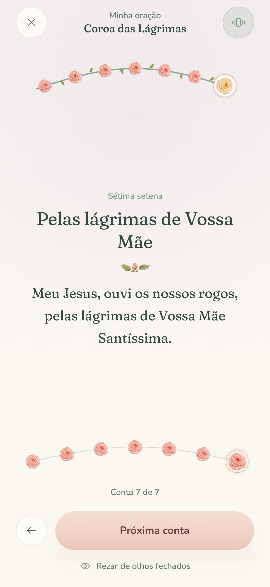
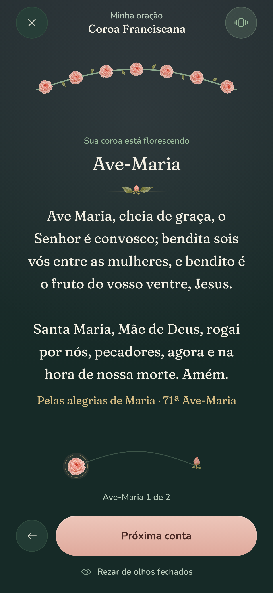
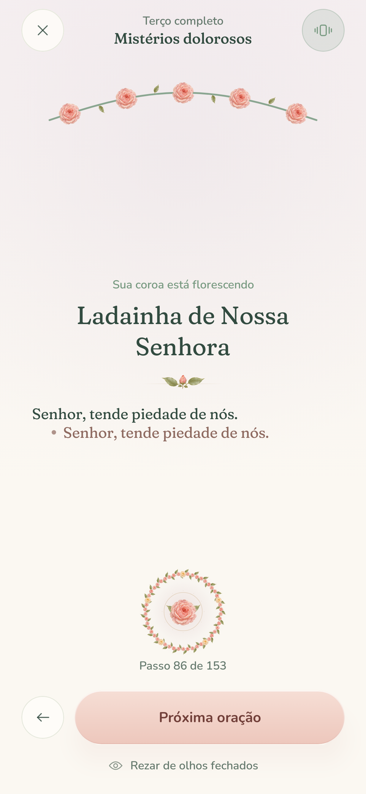

# Phase 2: implementation and content

All ten guides in Roteiros now begin a complete local prayer session. Tesouro and Meu Jardim remain the Phase 3 and 4 placeholders. No account, network service, or new production dependency is required.

The [devotional artwork collection](artwork/devotions/README.md) adds eight coordinated sacred paintings to the library, guide sheets, and delivered crowns. Portraits distinguish each devotion; the interactive stems and beads still show its exact structure. Denser delivered crowns scale their roses and leaves to retain all 49 or 72 flowers. Pages gently fade beneath their fixed headers in both Day and Vigil.

| Seven setenas | Franciscan final pair | Responsive litany |
| --- | --- | --- |
|  |  |  |

## Sequence structures

| Script | Opening and groups | Closing |
| --- | --- | --- |
| Traditional / catechetical | Existing 59-bead, 80-step rosary; catechetical cards explain the steps | Infinitas Graças and Salve Rainha |
| Complete | Traditional rosary plus Maria, Mãe da Graça after each Fatima prayer | Salve Rainha, all 67 Loreto calls and responses, then Concedei, nós Vos pedimos |
| Family / sick / peace | Traditional rosary plus a distinct offering; a specific contemplation for each of the twenty mysteries | Infinitas Graças and Salve Rainha |
| Divine Mercy | Sign of the Cross, Our Father, Hail Mary, Creed; 5 × (Eterno Pai + 10 Passion pleas) | 3 × Deus Santo |
| Saint Joseph | Sign of the Cross; 5 × (announcement + Our Father + 10 São José, valei-nos + Glory Be) | Sign of the Cross |
| Tears | Sign of the Cross and opening offering; 7 × (large-bead offering + 7 pleas) | 3 × large-bead offering, then Ó Maria, Mãe de amor |
| Franciscan | Sign of the Cross; 7 × (joy + Our Father + 10 Hail Marys + Glory Be) | 2 Hail Marys, then Sign of the Cross |

Popular devotions have variants. Saint Joseph uses the five-mystery invocation form specified in this repository, rather than the separate seven-sorrows-and-joys devotion. The Franciscan crown follows the seven-joy form with two extra Hail Marys; 72 is its traditional devotional number. Optional additional prayers for the Pope or indulgences are not included in this script. The Crown of Tears uses its own invocations rather than substituting a seven-sorrows rosary.

## Content and references

`MysteryContent` and `MysteryContemplations` contain all twenty mysteries and exactly ten distinct meditations per mystery. The Scripture excerpts are short Portuguese editorial renderings of the cited verses; the surrounding narrative and reflections are editorial devotional writing, not additional Scripture. Fixed prayers remain in the read-only `FixedPrayer` catalog and take precedence over any reading attached to a step.

The Assumption and Coronation are explicitly distinguished from directly narrated biblical events. Their entries connect the scriptural imagery to the Church's teaching instead of inventing a Gospel account.

References for content and structure:

- Each mystery's Scripture citation is bundled in `MysterySet` and shown alongside its excerpt.
- [Catechism, Mary and the Church, especially §966](https://www.vatican.va/archive/ENG0015/__P2C.HTM): Assumption and heavenly queenship.
- [Rosarium Virginis Mariae, §§20–24](https://www.vatican.va/content/john-paul-ii/en/apost_letters/2002/documents/hf_jp-ii_apl_20021016_rosarium-virginis-mariae.html): the four mystery sets and contemplation of Christ.
- [Vatican Litany of Loreto](https://www.vatican.va/special/rosary/documents/litanie-lauretane_en.html), with the 2020 additions Mater misericordiae, Mater spei, and Solacium migrantium. The catalog includes the Trinitarian invocations, 54 Marian invocations, three Lamb of God responses, and final versicle before the collect.
- [Divine Mercy chaplet, Marian Fathers](https://www.thedivinemercy.org/message/devotions/pray-the-chaplet): opening prayers, five decades, and three concluding Holy God prayers.
- The Saint Joseph, Tears, and Franciscan structures are the devotional forms selected in [the repository's content specification](domain-and-liturgical-content.md#5-devotional-crowns--chaplet-specifications-aba-roteiros).

`ThemedMeditations` adds sixty prewritten intentions: one per mystery for each of family, the sick, and peace. These appear at the announcement and in the contemplation sheet. The fixed prayers and the Gospel meditations remain intact.

## Architecture and recovery

`PrayerScript` selects and caches an immutable sequence. `ChapletEngine` builds arbitrary groups from `ChapletDefinition`; each group carries its own large bead, small bead, count, optional mystery, and closing prayers. The default rosary builder preserves its original order.

The session uses the active sequence for forward/backward bounds, group and bead jumps, haptic boundaries, progress, completion, and recovery. Saved positions are clamped against the restored script's actual length. Both the seventh group and late litany steps survive saved-state recreation. The Franciscan closing pair remains individually selectable without introducing an eighth mystery.

The prayer header, tactile labels, garland, accessibility descriptions, resumed session caption, and delivered crown all describe the chosen script. The full-screen prayer still hides the bottom navigation bar. Later phases remain separate: Room history and persistent preferences are not part of this milestone.

## Validation

Run `./gradlew assembleDebug assembleDebugAndroidTest assembleRelease testDebugUnitTest lintDebug`.

Domain tests verify every script, all 200 bead lines, all 60 themed reflections, the complete litany, exact chaplet counts, and custom mixed group sizes. State tests traverse every script in both directions, validate all group/bead targets, recover late sessions, and check invocation haptics. Robolectric drives the real activity through seventh-setena recovery, the Franciscan closing pair, and every litany response through the collect. Screenshot tests render the same Compose screens.

Run `./gradlew connectedDebugAndroidTest` separately with an Android 13+ device or emulator for the existing device suite.
