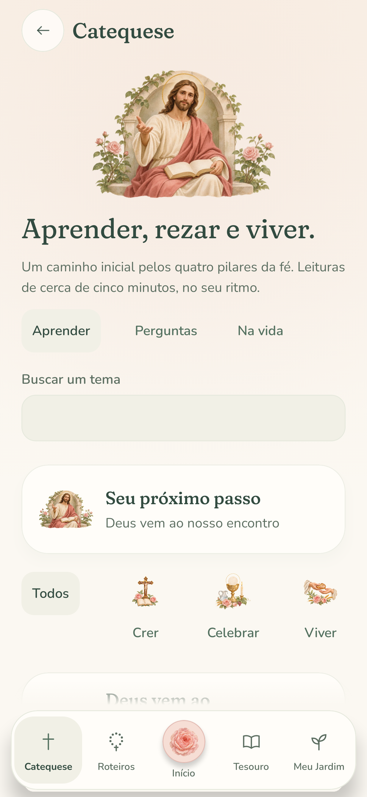
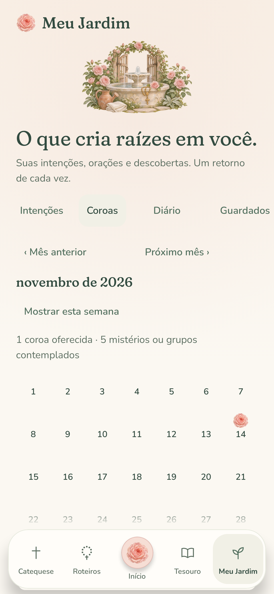
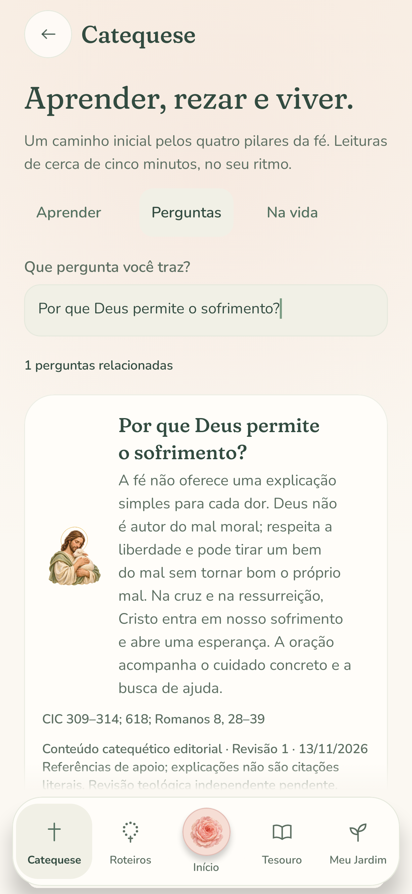

# Phase 4: a garden that remembers

Phase 4 replaces Meu Jardim's placeholder with an offline intention notebook, offered-crown garden, journal, bookmarks and learning history. It also adds an introductory formation experience. Connected source reading and guided audio are deliberately outside this implementation.

## The app-wide home and five destinations

The bottom bar has a fixed order: **Catequese · Roteiros · Início · Tesouro · Meu Jardim**. A rose in a distinct circular setting makes Início the central home destination. The order remains stable on narrow screens. When enlarged text cannot fit all labels, icons retain their spoken destination names and the selected destination gets a full-width label.

Início is a dashboard for the whole app: a compact Marian garden, date and welcome, four destination cards, prayer recovery, the next lesson, today's prayer entry and current intentions. The destination grid adapts to larger text. It contains no full mystery selector. Catequese is a dedicated formation center on the far left. Roteiros holds the prayer catalog and the full rosary preparation page, including mysteries, mode, intentions and a start action. Prayer still hides the bottom navigation.

## Personal continuity

`SertumDatabase` is a versioned Room database. Version 1's exported schema is checked in under `app/schemas`. Tables contain intentions, prayer sessions, immutable intention snapshots for each session, journal entries, bookmarks, lesson progress and content feedback. No destructive migration fallback is enabled.

`GardenRepository` owns an application-lifetime IO writer. Writes execute in order. A session upsert and its offering links are one transaction; other active sessions become replaced records when a new crown begins. Repeated completion/navigation cannot duplicate a crown. A blocked write stays queued along with later writes, displays a retry action, and retries in its original order. `flush` is a barrier for lifecycle checkpoints and tests.

Every prayer change saves a versioned session snapshot as well as Android saved state. Recovery reconciles the disk and Android revisions, including backward navigation, rather than assuming the highest bead is the newest position. A cold launch returns to the sanctuary with the paused crown available; rotation retains the current screen. The snapshot includes the actual guide, mystery set, solo/group mode, intentions and prayer position. Older Android-only sessions acquire an identifier when first attached to persistence.

Preferences DataStore saves appearance, prayer language, Treasury language, haptics, the meditated default, solo/group selection and dismissal of the introductory invitation. An unreadable preferences payload can be reset without deleting the Room database. The fixed rosary formulas can be read in Portuguese, Latin or both stacked in the prayer reader. These are reading choices, not complete interface translations.

## The intention notebook

Create and edit a title, description and one of six categories. Mark an intention in thanksgiving, with an optional personal note. Filter by category, archive it and restore it later. Archived intentions disappear from the next-crown picker without changing historical offerings. Counts include completed crowns only.

A sanctuary action opens the optional intention picker. The guide sheet provides the same choice. A new intention can be written and selected there. Starting prayer remains a single tap when no intention is selected. A paused crown keeps its original intentions even if the next-crown selection changes. The offered screen names the actual intentions and can save a reflection linked to that crown.

## The living garden

The month or current-week view shows roses on dates with completed crowns, period totals, and a list of offerings. Dates filter the list; detail sheets show guide, mystery set, solo/group mode, elapsed time, group count and the original intention titles. The grid adapts its column count to narrow screens. Empty periods invite a return without lost-day or streak language.

The journal supports creating, editing and deleting reflections, with confirmation before deletion. Bookmarked prayers and lessons reopen their content from Guardados. Caminho shows completed/read lessons, personal discoveries, and practical actions marked as lived. Personal records are stored locally. Android cloud backup excludes them; Android 12+ device transfer includes the database and preferences. Uninstalling without a device transfer removes local records.

## Formation, questions and daily practice

The Catequese center is accessible from its dedicated tab, Início, Treasury and Jardim. Sixteen original Portuguese lessons cover the four pillars: profession of faith, sacraments, moral life and prayer. Every lesson includes a learning objective, teaching, Scripture and Catechism references, a comprehension question with explanations, a concrete action, a short editorial prayer and an optional saved reflection. Answers carry no points. Correct understanding unlocks completion; readers can revisit any lesson. Returning readers are offered their unfinished lesson or the next unread lesson.

Twelve curated answers address common questions about Mary, repetition, suffering, confession, mortal sin, distraction, the Eucharist, Communion, forgiveness, grace, Baptism and beginning to pray. Search normalizes accents/case and ignores common connecting words; partial relevance retrieves related questions, with an explicit empty state. This is a finite editorial catalog, not an AI response service.

Four practical journeys cover participation in Mass, preparation for confession, an evening review, and works of mercy. A lesson explains the liturgical year while directing readers to their parish for local dates and transferred celebrations. This implementation does not invent a universal local calendar.

## Artwork throughout the new destinations

[Twelve original model-generated paintings](artwork/formation-and-garden/README.md) now accompany the whole-app home, Catequese and Meu Jardim. Christ teaching and a fountain garden establish the two centers. Distinct paintings identify the four pillars, petitions, journal, saved readings, questions, reconciliation and the liturgical year. Every lesson and practical guide opens with contextual artwork; personal empty states and saved records have illustrations too. Search puts the large formation painting aside, and entering a lesson or guide starts at its heading.

The complete transparent compositions fit their frames in Day and Vigil. Decorative images do not replace accessible labels, and the interactive crown garden retains its dynamic roses and counts. The twelve optimized WebPs total 1.06 MiB; full-resolution masters, generation prompts and edit references are preserved outside the APK.

## Editorial accountability

The new content identifies itself as editorial teaching with a revision and date. It includes supporting references and explicitly states that independent theological review is pending. No reviewer, approval or ecclesial endorsement is fabricated. A reader can save a correction on the device or explicitly share the text through Android's chooser. Saving feedback alone does not transmit it to a maintainer. These references do not open a connected source reader.

A qualified theological review, human usability sessions and additional interface translations remain human/product follow-up work. Lumen's online AI, iOS and guided audio are not implemented by this phase.

## Compatibility and verification

The minimum Android version is now API 26 (Android 8). Vibration selects the legacy Vibrator service before API 31. Instrumented Kotlin test method names use DEX-compatible identifiers for this minimum SDK. The app retains its custom Compose Foundation controls and no Internet permission.

Device test fixtures reset their local database and preferences before launching each case; run them on a clean emulator or a dedicated test device.

New tests exercise real Room operations, transaction/idempotency behavior, disk/Android reconciliation, preference separation, saved bookmarks/reflections/learning, failed-write retries, content integrity, natural-language search, and actual Compose offering/formation flows. Native-rendered previews are generated by `GardenFormationFlowTest` when Roborazzi recording is enabled.

```sh
./gradlew assembleDebug assembleDebugAndroidTest assembleRelease testDebugUnitTest lintDebug
./gradlew recordRoborazziDebug --tests '*HomeHubTest' --tests '*GardenFormationFlowTest' --tests '*FormationArtworkFlowTest' --tests '*PocoDisplayLayoutTest'
python3 tools/treasury/treasury.py generate --check
python3 -m unittest discover -s tools/treasury/tests -v
```

## Rendered previews

These are native Compose renders from the JVM UI tests, not photographs of a physical device.

| Início · Day | Início · Vigil | Catequese |
| --- | --- | --- |
|  |  |  |

| Intentions | Crown garden | A question of faith |
| --- | --- | --- |
|  |  |  |
