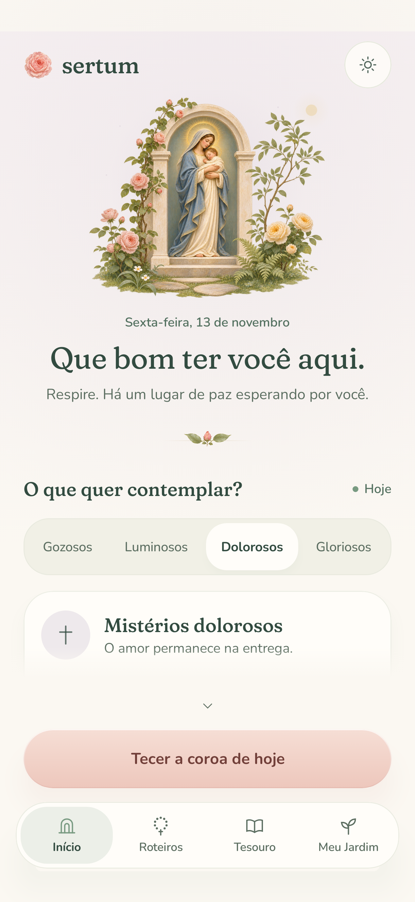
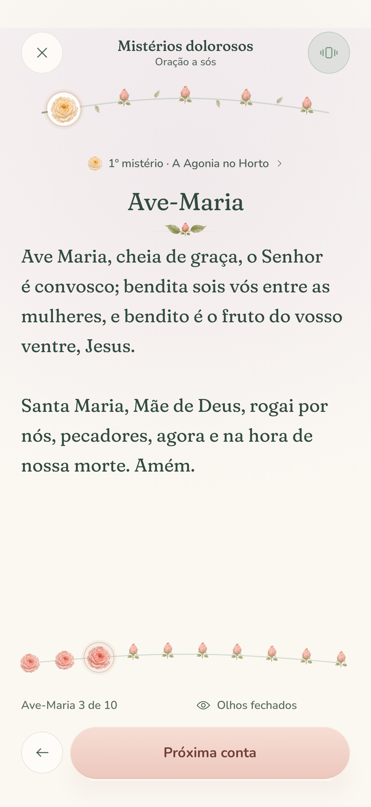
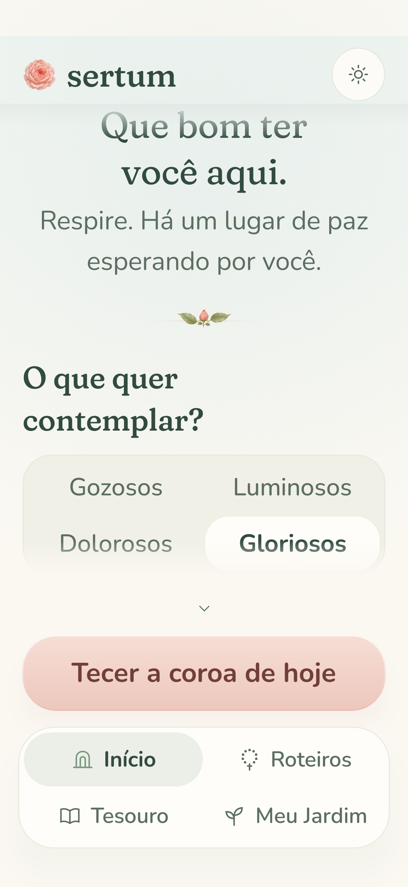
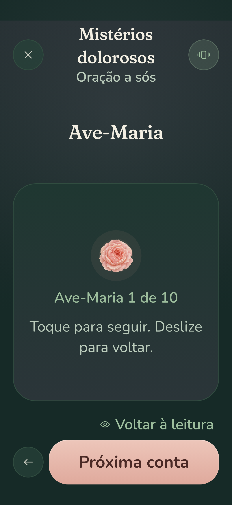

# POCO X8 Pro display and layout

## Reference device

[Xiaomi's official POCO X8 Pro specifications](https://www.mi.com/uk/product/poco-x8-pro/specs/), checked 13 November 2026, list a **6.59-inch AMOLED display, 1268 × 2756 physical pixels, up to 120 Hz**. Its portrait aspect ratio is approximately **1:2.1735**. These are the Pro specifications; the Pro Max has a different display.

Physical pixels are not Android layout units. HyperOS display size, font size, system bars, and rotation change the space available to Compose. The app uses dp for layout, sp for text, and safe drawing insets for the status bar, camera cutout, and navigation area. It does not select a layout by model name or force a particular density, font scale, or refresh rate.

## Layout refinements

- Balanced serif headings, Portuguese paragraph breaking, and consistent font metrics align visible text and reduce awkward short final lines. Prayer text retains its 21 sp size, 34 sp line height, and left alignment for continuous reading.
- Pages use 24 dp side margins, reduced to 20 dp below 380 dp available screen width. The home painting scales with the page height, leaving room for the greeting and mystery choices.
- Mystery choices share one row at normal phone sizing. Each gets room for its own full label, measured at the selected weight, with modest side padding. Larger text can reflow into two columns, or one if needed, without shrinking the font or changing the grid when a selection changes. The selector no longer allocates four copies of the longest label's width, which made it split into two rows too early.
- The bottom shelf reserves its measured height. Labels wrap at word boundaries, and the shelf reflows to two rows with icons beside labels when four columns would split a word. All destinations grow together, keeping page actions above navigation at larger font sizes.
- Devotional titles and mystery links wrap. Numbered meditations grow with the font. Sheets retain their standing action, and completion artwork fits within the reading column.
- Supporting text and sage captions use stronger contrast in Day. The lighter sage remains in botanical artwork and surface accents.
- Short and long prayers use the same top reading anchor, keeping the heading and first line still when scroll controls appear. Mystery sections reset their scroll position before layout and fade in at their final size, avoiding a height animation from the previous section.
- Landscape prayer keeps its reading area and controls; the eyes-closed surface uses a compact rose and bead label when height is limited.

## Verification

`PocoDisplayLayoutTest` exercises the real Compose interface with Robolectric native Android graphics:

| Profile | Layout fixture | Text |
| --- | --- | --- |
| Tall portrait | 423 × 919 dp at 480 dpi | Standard |
| Narrow portrait | 360 × 783 dp at 480 dpi | 1.1×, single-row mysteries |
| Medium portrait | 393 × 854 dp at 480 dpi | 1.2×, single-row mysteries |
| Larger display and text | 362 × 787 dp at 560 dpi | 1.6× and 1.8× |
| Landscape | 919 × 423 dp at 480 dpi | Standard |

The density values are representative test settings, not a claimed HyperOS factory default. Integer dp rounding can differ from the physical panel by a few pixels. The fixtures also reserve a representative 32 dp status/camera area and 24 dp gesture area. Native `safeDrawing` insets remain responsible for the actual device's bars and cutout.

`PrayerReaderStabilityTest` also samples section switches frame by frame from the bottom of the reading area and compares the heading, tabs, card, navigation, scroll offset, and cue state. It checks the offering-to-Creed transition and changing content around the scroll threshold.

The checks cover text overflow, reachable mystery choices, all four tabs, prayer alignment, large text paging, full touch targets, tactile mode, guide sheets, and the delivered crown. Record the device-profile previews with:

```sh
./gradlew recordRoborazziDebug --tests 'com.sertumrosarum.PocoDisplayLayoutTest'
./gradlew recordRoborazziDebug --tests 'com.sertumrosarum.PrayerReaderStabilityTest'
```

## Rendered previews

[Single-row mystery selector at 393 dp with 1.2× text, in Vigil](screenshots/poco-x8-pro/mysteries-one-row-vigil.png).

[Prayer section motion preview](screenshots/poco-x8-pro/reading-motion.mp4) samples switching from the bottom of a section through Sentido, Cena, and Fruto. It uses native Android render frames with controlled animation times. [Offering](screenshots/poco-x8-pro/stable-offering.png) and [Creed](screenshots/poco-x8-pro/stable-creed.png) show the matching heading and first-line positions with and without scrolling controls.

<table>
  <tr><th>Portrait sanctuary</th><th>Portrait prayer</th></tr>
  <tr>
    <td></td>
    <td></td>
  </tr>
  <tr><th>Larger display · 1.6× text</th><th>Eyes closed · 1.8× text</th></tr>
  <tr>
    <td></td>
    <td></td>
  </tr>
</table>

These are rendered Android layout checks. A physical POCO X8 Pro is still needed to assess its exact HyperOS density, cutout geometry, and 120 Hz frame pacing.
