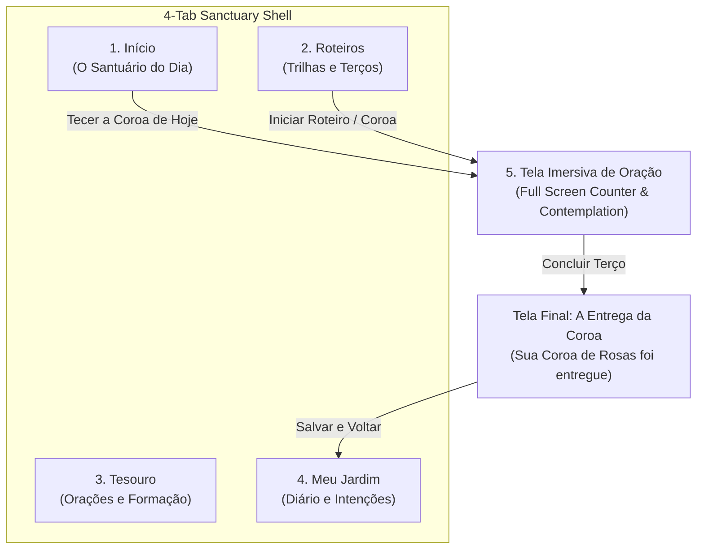

# 🌹 Product Vision & Experience Architecture

> Current visual direction: **O Jardim de Maria**. The [design system](design-system.md) defines the user-selected quiet garden, rounded type, and original botanical illustrations.

> **Official Name:** `Sertum Rosarum: O Santo Terço`  
> **Launcher Short Name:** `Sertum`  
> **Contemplative AI Engine:** `Lumen` (*Luz para contemplação*)  
> **Primary Tagline:** *"Teça a sua coroa diária de contemplação."*  
> **Secondary Taglines:** *"Uma coroa de rosas a cada oração."* | *"Silêncio, ritmo e devoção."*

---

## 1. Purpose & Core Problem Statement

**Sertum Rosarum** (*"Crown of Roses"*, the original Latin expression that gave rise to the word *Rosary*) is not merely a digital bead counter for Hail Marys. It is designed as a **silent sanctuary in your pocket** (*um santuário silencioso no bolso*) and a **school of contemplative prayer** (*uma escola de oração contemplativa*).

### Who It Serves
The application resolves the central challenge of praying the Rosary across two primary user profiles:

1. **The Beginner (`O Iniciante`)**:
   * Wants to pray the Rosary or learn Catholic devotions but feels intimidated by the sequence of prayers, the switching of mysteries by day of the week, or unfamiliar theological vocabulary (*"Consubstancial ao Pai"*, *"Vale de lágrimas"*).
   * Needs gentle, step-by-step guidance that explains *what* to pray and *why* each prayer exists without cluttering the moment of devotion.
2. **The Experienced Faithful (`O Fiel Experiente`)**:
   * Prays the Rosary regularly (often daily, while commuting, walking, or at night before sleep) but struggles against mental distraction, spiritual dryness, and "autopilot" repetition.
   * Needs tactile, eyes-closed counting mechanics, deep biblical and patristic contemplation, Latin prayer options, and a way to connect the Mysteries of Christ's life directly to their daily crosses, intentions, and thanksgivings.

---

## 2. Brand Identity

### Naming Conventions
| Context | Name | Rationale |
| :--- | :--- | :--- |
| **Play Store & Splash Screen** | `Sertum Rosarum: O Santo Terço` | Conveys both the classical sacred heritage (*Sertum Rosarum*) and immediate functional clarity in Portuguese (*O Santo Terço*). |
| **Android Home Screen Icon** | `Sertum` | Concise single-word label that prevents ellipsis truncation across Android launchers. |
| **Integrated AI Catechist** | `Lumen` | Latin for *Light*; represents the theological light that illuminates the Mysteries of Christ without feeling like a generic chatbot. |

### Icon Concept
* **Background:** Vigil Blue (`#0F172A`), evoking the quiet recollection of night vigil prayer and stained-glass twilight.
* **Foreground:** A geometric rose stylized in a single continuous Golden stroke (`#C59B27`), viewed from above and inspired by the **rose windows of Gothic cathedrals** (*rosáceas góticas*).
* **Perimeter:** Surrounded by a ring of **10 golden points** symbolizing both a royal/floral crown and a single decade of the Rosary.

---

## 3. Core Prayer Mechanics & Metaphors

### 3.1 The "Crown of Roses" Metaphor (`A Metáfora da Coroa de Rosas`)
Historically, Christians offered spiritual roses to Our Lady with each prayer. Sertum Rosarum translates this theological reality into three visual mechanics:

1. **Blooming Beads (`Contas que Florescem`)**:
   * During each decade, the 10 *Ave-Marias* are rendered as a fluid arc of 10 hollow circles.
   * As each *Ave-Maria* is prayed, the active bead fills with warm liturgical gold/ruby and subtly blooms into a minimalist Gothic rose window (*rosácea*).
2. **The 5-Mystery Arc (`O Arco dos 5 Mistérios`)**:
   * At the top of the immersive prayer screen, a circular or arched ring divided into 5 segments illuminates progressively as each decade is completed, closing the full crown upon reaching the *Salve Rainha*.
3. **The Delivery of the Crown (`A Entrega da Coroa`)**:
   * Upon concluding the Rosary, the completed golden rose crown glows on the final screen with the solemn message: **"Sua Coroa de Rosas foi entregue"**, accompanied by the personal intentions the user placed at the start of the prayer.

### 3.2 "Eyes Closed" Mode (`Modo Olhos Fechados — Navegação Tátil`)
Because contemplative prayer often happens with eyes closed, in a darkened bedroom, or while walking:
* **Wide Touch Zone (`Área de Toque Ampla`)**: During the decades, tapping or swiping anywhere across the lower half of the screen advances one bead—never requiring visual precision on a tiny button.
* **Differentiated Haptic Feedback (`Vibração Diferenciada`)**:
  * **Ave-Maria Bead:** A short, soft tactile pulse confirming the bead advance.
  * **Pai-Nosso / Glória / Mystery Transition:** A richer double vibration alerting the user by touch alone that the decade has concluded and a new mystery or closing prayer has begun.

---

## 4. Progressive Educational Architecture

Sertum Rosarum teaches while guiding prayer, using **progressive disclosure layers** so the main prayer screen always remains serene and uncluttered.

### 4.1 The Mysteries in 4 Dimensions (`Os Mistérios em 4 Dimensões`)
Before each *Pai-Nosso* (and on demand during the decade), the Mystery card offers four contemplative dimensions:
1. **The Biblical Scene (`A Cena Bíblica`)**: The Gospel passage paired with historical, geographical, and sensory context.
2. **The Contemplative Meaning (`O Sentido da Contemplação`)**: Accessible theological explanation of what the mystery reveals for Christian life.
3. **The Fruit of the Mystery (`O Fruto do Mistério`)**: The specific virtue associated with the decade (e.g., *Humildade*, *Perseverança*, *Confiança em Deus*) translated into a concrete attitude for the day.
4. **Bead-by-Bead Meditated Rosary (`Terço Meditado Conta a Conta` — Optional)**: When toggled on, displays a distinct short contemplative sentence on each of the 10 *Ave-Marias*, guiding the user's imagination step-by-step through the biblical scene.

### 4.2 The Treasury of Prayers (`O Tesouro de Orações`)
A structured library of Catholic prayers organized by moment of life (*Ao acordar, Antes de dormir, Na angústia, Ação de graças, Pós-Comunhão*) and traditional devotions:
* **Anatomy of Prayer (`"Toque para Entender"`)**: In classic prayers such as the *Credo*, *Salve Rainha*, or *Anima Christi*, theological or archaic expressions (e.g., *"Vale de lágrimas"*, *"Consubstancial ao Pai"*) are subtly marked. Tapping a phrase opens a bottom sheet explaining its biblical and historical meaning.
* **Bilingual Mode (`Português / Latim`)**: Instant toggle or side-by-side comparison for the universal prayers of the Church (*Pater Noster, Ave Maria, Gloria Patri, Symbolum Apostolorum, Salve Regina, Sub Tuum Praesidium, Regina Caeli, Angelus*), complete with literal Latin term explanations.

### 4.3 Ready-Made Prayer Scripts (`Roteiros de Oração Prontos`)
* **Catechetical Beginner Script (`Roteiro Catequético`)**: Explains the purpose of every step (Sign of the Cross, Offering, the 3 Hail Marys for Faith, Hope, and Charity).
* **Complete Traditional Script (`Roteiro Tradicional Completo`)**: Includes all traditional jaculatories (*Ó meu Jesus*, *Maria, Mãe da Graça*), *Infinitas Graças*, *Salve Rainha*, and the **Litany of Loreto (`Ladainha Lauretana`)**.
* **Other Devotional Crowns (`Outras Coroas Devocionais`)**: Structured scripts and custom bead counters for the *Terço da Divina Misericórdia*, *Terço de São José*, *Coroa das Lágrimas*, and *Coroa Franciscana*.

---

## 5. Information Architecture & Screen Inventory

The application is structured around **4 main bottom-navigation tabs** plus the **Full-Screen Immersive Prayer Screen**:

| Screen / Tab | Purpose & Key Elements |
| :--- | :--- |
| **1. Início (`O Santuário do Dia`)** | Liturgical greeting, automatic indication of the Mystery of the Day, primary CTA **"Tecer a Coroa de Hoje"**, resume-in-progress card, and the quick **Lumen** input field (*"O que você traz no coração para este terço?"*). |
| **2. Roteiros (`Trilhas e Terços`)** | Selection between Traditional Rosary, Beginner Explained Rosary, Bead-by-Bead Meditated Rosary, Thematic Rosaries (*Pela Família, Pelos Enfermos, Pela Paz*), and Other Devotional Crowns. |
| **3. Tesouro (`Orações e Formação`)** | Prayer library with *"Toque para Entender"* annotations, *Português / Latim* bilingual reader, and the comprehensive 20 Mysteries Study Guide. |
| **4. Meu Jardim (`Diário e Intenções`)** | Visual history of completed "Crowns of Roses" (focused on peaceful spiritual constancy rather than anxious streak gamification) and the personal/family Intention Notebook. |
| **5. Tela Imersiva de Oração (`Full Screen`)** | Distraction-free full-screen view with no bottom navigation bar. Displays the 5-Mystery Arc at the top, prayer/meditation text in the center, the 10 Blooming Beads arc, wide Eyes-Closed touch zone, and a discreet top-corner **Lumen** button (*"Compreender este mistério"*). |
