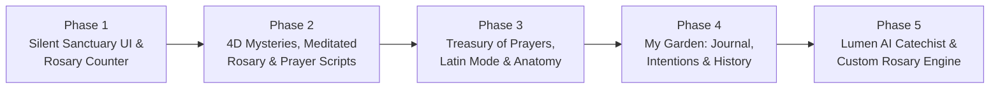

# 🌹 Sertum Rosarum — Development Phases & Milestone Plan (`phases.md`)

> **"Teça a sua coroa diária de contemplação."**  
> This document defines the phased engineering roadmap for building **Sertum Rosarum: O Santo Terço**.  
> Every phase is a **complete, vertical-slice milestone** that delivers user-visible value, adheres strictly to the **no-Material custom Compose design system**, and leaves the codebase green (`./gradlew testDebugUnitTest lintDebug`).

---

## Roadmap Overview

| Phase | Milestone Name | Core Deliverable | Key User Capability |
| :--- | :--- | :--- | :--- |
| **Phase 1** | **Silent Sanctuary UI & Interactive Rosary Counter** | Custom Design System + Sanctuary Home + Full-Screen Rosary Counter | Pray and count the complete Holy Rosary with blooming rose beads, 5-mystery crown arc, dynamic mystery atmosphere, and "Eyes Closed" haptic mode. |
| **Phase 2** | **Mysteries in 4 Dimensions & Prayer Scripts (`Roteiros`)** | 4-Tab Navigation Shell + 4D Mystery Cards + Bead-by-Bead Meditations + Devotional Crowns | Pray with deep biblical/theological context, bead-by-bead contemplative prompts, Beginner Catechetical script, Litany of Loreto, and Divine Mercy / St. Joseph chaplets. |
| **Phase 3** | **The Treasury of Prayers (`Tesouro`)** | Categorized Prayer Library + "Touch to Understand" + Portuguese/Latin Bilingual Mode + 20 Mysteries Study Guide | Study the 20 Mysteries and pray classic Catholic prayers with tap-to-explain theological terms and side-by-side Latin translations. |
| **Phase 4** | **My Garden (`Meu Jardim`) — Intentions & Contemplative History** | Room + DataStore Persistence + Pre-Prayer Intentions + Visual Crown Garden + Intention Notebook | Dedicate each Rosary to personal/family intentions, resume interrupted prayers, and track spiritual constancy through a peaceful garden of completed crowns. |
| **Phase 5** | **Lumen — Contemplative AI Catechist & Custom Script Engine** | Structured AI Service + Doctrinal Guardrails + Live Intention Rosary + Contextual Catechist + Mood Curation | Generate custom offerings and Gospel-anchored meditations for real-life struggles, ask contextual questions about any mystery, and receive gentle thanksgiving reminders. |

---

## Phase 1: The Silent Sanctuary UI & Interactive Rosary Counter

### Goal & Milestone Vision
Deliver a **breathtaking, contemplative user interface** ("Santuário Silencioso") from day one, paired with a **complete, tactile, end-to-end Holy Rosary prayer and bead-counting experience**. By the end of Phase 1, a user can open the app, experience the warm parchment (Day) or vigil blue (Night) aesthetic with dynamic liturgical colors for the Mystery of the Day, tap **"Tecer a Coroa de Hoje"**, and pray/count an entire 5-decade Rosary from the Sign of the Cross to the final **"Sua Coroa de Rosas foi entregue"** screen.

### Scope & Features

#### 1. Custom Design System ("Santuário Silencioso" — Zero Material)
* **Custom Theme Architecture (`ui/theme`)**:
  * Built exclusively on `androidx.compose.ui` and `androidx.compose.foundation` (`CompositionLocalProvider` for `SertumColors`, `SertumTypography`, `SertumSpacing`, `SertumShapes`, and `MysteryAtmosphere`).
  * **Day Mode (`Modo Claro — Dia`)**: Pergaminho Quente (`#F9F6F0`) background, Linho Puro (`#EFECE6`) surfaces/cards, Tinta Escura (`#1C1917`) primary text, Ouro Velho (`#C59B27`) primary accent, Rubi Litúrgico (`#881337`) secondary accent, Azul Mariano (`#1E3A8A`) institutional accent.
  * **Vigil Mode (`Modo Escuro — Vigília`)**: Azul Vigília (`#0F172A`) background, Ardósia Noturna (`#1E293B`) surfaces/cards, Marfim Suave (`#F8FAFC`) primary text, Ouro Luminoso (`#EAB308`) primary accent, Rosa Antigo (`#FDA4AF`) secondary accent, Azul Celeste (`#93C5FD`) institutional accent.
  * **Dynamic Mystery Atmosphere (`Atmosfera Dinâmica por Mistério`)**: Header gradients and subtle ambient accents that shift automatically by mystery set:
    * *Mistérios Gozosos (Mon / Sat)*: Warm Amber & Soft Gold.
    * *Mistérios Luminosos (Thu)*: Solar Gold & Luminous White.
    * *Mistérios Dolorosos (Tue / Fri)*: Deep Violet & Liturgical Wine.
    * *Mistérios Gloriosos (Wed / Sun)*: Celestial Blue & Gold.
  * **Typography System**: Bundled Google Fonts (`Cinzel` for solemn uppercase titles with wide letter-spacing, `Cormorant Garamond` / `Lora` for prayer texts and meditations, `Plus Jakarta Sans` for UI labels, buttons, and bead counters).
  * **Brand Icon**: Adaptive vector launcher icon featuring a single-stroke golden gothic rose window (`#C59B27`) surrounded by 10 golden beads on a Vigil Blue (`#0F172A`) background.

#### 2. Sanctuary Home Screen (`Início — O Santuário do Dia`)
* **Liturgical Header**: Displays the current day of the week, liturgical greeting, theme toggle (Dia / Vigília / System), and automatic selection of the **Mystery of the Day** (with a horizontal pill selector allowing the user to manually switch between *Gozosos*, *Luminosos*, *Dolorosos*, and *Gloriosos*).
* **Mystery of the Day Card**: Displays the active Mystery set title, contemplative theme, and a preview list of the 5 mysteries for the day.
* **Primary Call to Prayer**: Prominent, sacred CTA button **"Tecer a Coroa de Hoje"** (styled in Liturgical Ruby / Antique Rose with subtle golden border) that launches the full-screen Rosary counter.

#### 3. Full-Screen Immersive Rosary Counter (`Tela Imersiva de Oração`)
* **Rosary Session State Machine (`domain/prayer`)**:
  * Models the complete step-by-step sequence of the Holy Rosary (59 beads / steps):
    1. *Sinal da Cruz* & *Oferecimento do Terço*
    2. *Credo Apostólico* (Crucifix)
    3. *Pai-Nosso* (1st large bead)
    4. *3 Ave-Marias* (for the virtues of Faith, Hope, and Charity) + *Glória ao Pai*
    5. **5 Decades** (for each of the 5 Mysteries of the selected set):
       * *Anúncio do Mistério* + *Pai-Nosso*
       * *10 Ave-Marias* (counted 1/10 through 10/10)
       * *Glória ao Pai* + *Jaculatória de Fátima ("Ó meu Jesus...")*
    6. Closing prayers: *Infinitas Graças* & *Salve Rainha*.
* **The 5-Mystery Crown Arc (`O Arco dos 5 Mistérios`)**:
  * Custom Compose `Canvas` header component displaying a 5-segment golden ring that illuminates segment by segment as each decade is completed, closing the full crown upon reaching the *Salve Rainha*.
* **Blooming Rose Beads (`Contas que Florescem`)**:
  * Custom Compose `Canvas` component rendering the 10 Hail Marys of the active decade as a fluid arc of 10 hollow circles.
  * As each Hail Mary is prayed, the active bead pulses gently, fills with liturgical gold/ruby, and blooms into a delicate minimalist gothic rose window (`rosácea`) with smooth spring animations.
  * Direct bead tap support + Next/Previous step controls + current bead counter badge (e.g., `Ave-Maria 4 de 10 • 2º Mistério Gozoso`).
* **"Eyes Closed" Tactile Navigation (`Modo Olhos Fechados`)**:
  * Toggleable or always-ready wide gesture zone covering the lower half of the screen: tapping or swiping anywhere advances one bead without looking at the screen.
  * **Differentiated Haptic Feedback (`VibrationEffect` on Android 13+)**:
    * *Ave-Maria bead advance*: Short, soft single tactile pulse.
    * *Pai-Nosso / Glória / Decade transition*: Rich double-pulse vibration signaling by touch alone that the decade has ended.
* **Crown Delivery Completion Screen (`A Entrega da Coroa`)**:
  * Upon completing the final prayer, the full 5-decade golden rose crown illuminates in the center of the screen with the solemn message **"Sua Coroa de Rosas foi entregue"**, total prayer duration, and a button to return peacefully to the Sanctuary.

### Technical Deliverables & Acceptance Criteria
* Zero dependencies on `androidx.compose.material` or `androidx.compose.material3`.
* Complete unit test suite for `RosarySequenceBuilder`, `PrayerSessionViewModel` (stepping forward/backward across all 59+ steps, jumping between decades, switching mystery sets, automatic day-of-week mystery resolution), and Compose UI tests for the Rosary counter flow.
* `./gradlew assembleDebug testDebugUnitTest lintDebug` passes with zero errors.

---

## Phase 2: The 4-Dimensional Mysteries & Prayer Scripts (`Roteiros`)

### Goal & Milestone Vision
Transform the app from a beautiful Rosary counter into a **school of contemplative prayer**. Phase 2 introduces the **4-tab navigation architecture**, enriches every Rosary decade with the **4 Dimensions of the Mysteries** (including the optional **Bead-by-Bead Meditated Rosary**), and builds the **Roteiros (Prayer Scripts & Devotional Crowns)** tab so beginners and experienced faithful alike can choose tailored ways to pray.

### Scope & Features

#### 1. Multi-Tab Sanctuary Navigation Shell
* Custom non-Material bottom navigation bar (`SertumBottomBar`) with 4 tabs:
  1. **Início** (*O Santuário do Dia*)
  2. **Roteiros** (*Trilhas e Terços*)
  3. **Tesouro** (*Orações e Formação* — placeholder shell ready for Phase 3)
  4. **Meu Jardim** (*Diário e Intenções* — placeholder shell ready for Phase 4)
* Entering the **Immersive Prayer Screen** smoothly hides the bottom navigation bar for full-screen focus.

#### 2. The Mysteries in 4 Dimensions (`Os Mistérios em 4 Dimensões`)
* Complete theological dataset for all **20 Mysteries of the Rosary** (Gozosos, Luminosos, Dolorosos, Gloriosos).
* Before each *Pai-Nosso* (and accessible via an expandable contemplative sheet during the decade), the Mystery card presents progressive layers:
  1. **A Cena Bíblica (Narrative)**: Gospel passage citation and text accompanied by historical and sensory context.
  2. **O Sentido da Contemplação (Meaning)**: Accessible theological reflection on what the mystery reveals about Christ and our faith.
  3. **O Fruto do Mistério (Virtue)**: The specific virtue of the decade (e.g., *Humildade*, *Amor ao Próximo*, *Perseverança*, *Confiança em Deus*) translated into a concrete daily attitude.
  4. **Terço Meditado Conta a Conta (Bead-by-Bead Meditation — Optional Toggle)**: When enabled, displays a distinct short contemplative sentence on each of the 10 *Ave-Marias* (200 total meditations across the 20 mysteries), guiding the user's imagination step-by-step through the Gospel scene.

#### 3. Prayer Scripts & Devotional Crowns (`Aba Roteiros`)
* **Rosary Script Variants**:
  * **Roteiro Catequético (Iniciante)**: Includes gentle inline catechetical cards explaining *why* each step is prayed (e.g., the meaning of the Sign of the Cross, why 3 Hail Marys are prayed for Faith, Hope, and Charity).
  * **Roteiro Tradicional Completo**: Includes all traditional jaculatories (*Ó meu Jesus*, *Maria, Mãe da Graça*), *Infinitas Graças*, *Salve Rainha*, and the complete **Ladainha Lauretana (Litany of Loreto)** with responsive invocations (*Rogai por nós*, *Tende piedade de nós*).
  * **Terços Temáticos**: Pre-crafted contemplative Rosary scripts with specific mystery meditations **Pela Família** (For the Family), **Pelos Enfermos** (For the Sick), and **Pela Paz** (For Peace).
* **Other Devotional Crowns (`Outras Coroas Devocionais`)**:
  * Generalized `ChapletEngine` supporting custom crown structures and bead counts:
    * **Terço da Divina Misericórdia** (*Pai Eterno* on large beads + 10 *"Pela Sua dolorosa Paixão..."* on small beads + 3x *"Deus Santo, Deus Forte, Deus Imortal"*).
    * **Terço de São José** (Mysteries of St. Joseph + custom bead invocations).
    * **Coroa das Lágrimas de Nossa Senhora** (7 septets of 7 beads instead of 5 decades of 10; dynamic adaptation of the top crown arc and bead canvas).
    * **Coroa Franciscana (Terço das 7 Alegrias de Nossa Senhora)** (7 decades / 72 Ave-Marias).

### Technical Deliverables & Acceptance Criteria
* Flexible `PrayerScript` and `ChapletDefinition` domain models supporting 5-decade Rosaries, 7-decade Franciscan crowns, and 7-septet Crowns of Tears.
* Dynamic Canvas bead renderer adapting seamlessly to 7-bead or 10-bead groups.
* Unit tests covering all script generators, bead-by-bead meditation indexing, and Litany of Loreto progression.

---

## Phase 3: The Treasury of Prayers — Bilingual Latin & "Touch to Understand" (`Tesouro`)

### Goal & Milestone Vision
Complete the **Tesouro (Orações e Formação)** tab, turning the app into a rich liturgical and catechetical reference library. Users can browse prayers by moment of life, tap highlighted theological terms to understand their biblical roots (**"Toque para Entender"**), pray or study in **Portuguese / Latin Bilingual Mode** (including inside the Rosary counter itself), and explore the full **20 Mysteries Study Guide**.

### Scope & Features

#### 1. Categorized Prayer Library (`O Tesouro de Orações`)
* Curated collection organized by **Moment of Life**:
  * *Ao Acordar* (Morning Offering, *Veni Sancte Spiritus*, *Angelus*)
  * *Antes de Dormir* (Examination of Conscience, Night Prayer, *Sub Tuum Praesidium*)
  * *Na Angústia e Tribulação* (*Lembrai-vos / Memorare*, Prayer of St. Teresa *"Nada te perturbe"*, Psalm 22/90)
  * *Ação de Graças* (*Magnificat*, *Te Deum*)
  * *Pós-Comunhão* (*Alma de Cristo / Anima Christi*, Prayer to Christ Crucified *"Eis-me aqui, ó bom e dulcíssimo Jesus"*)
  * *Devoções Marianas e Tradicionais* (*Credo Apostólico*, *Credo Niceno-Constantinopolitano*, *Salve Rainha*, *Regina Caeli*, *Ladainha Lauretana*, *Ato de Contrição*).
* Instant search and category filtering with a distraction-free editorial reading view.

#### 2. Anatomy of Prayer ("Toque para Entender")
* Annotated text parser and custom clickable spans in prayers like *Credo*, *Salve Rainha*, *Anima Christi*, *Pai-Nosso*, and *Sub Tuum Praesidium*.
* Highlighted theological or archaic terms (e.g., *"Vale de lágrimas"*, *"Consubstancial ao Pai"*, *"Remissão dos pecados"*, *"Eia, pois, Advogada nossa"*, *"Iníquos"*).
* Tapping any underlined/highlighted term opens a custom **Sacred Bottom Sheet (`Gaveta Explicativa`)** showing:
  * The expression and its literal/etymological origin.
  * Biblical references and Catechism context.
  * What the phrase means when we pray it today.

#### 3. Bilingual Mode (`Modo Bilíngue Português / Latim`)
* **Side-by-Side & Instant Toggle**: View major prayers of the Church (*Pater Noster*, *Ave Maria*, *Gloria Patri*, *Symbolum Apostolorum*, *Salve Regina*, *Sub Tuum Praesidium*, *Regina Caeli*, *Angelus*, *Anima Christi*, *Magnificat*) either in Portuguese, in Ecclesiastical Latin, or aligned verse-by-verse side by side.
* **Literal Latin Breakdown**: Word/phrase-level Latin-to-Portuguese breakdown for learners who want to understand the Latin text they are praying.
* **Latin Rosary Integration**: Adds a quick **PT | LAT** toggle inside the **Immersive Rosary Counter** so the user can pray the entire Rosary in Latin (*Pater Noster*, *Ave Maria*, *Gloria Patri*, *Salve Regina*) at any time.

#### 4. Complete 20 Mysteries Study Guide
* Dedicated formation view inside `Tesouro` allowing users to browse and study all 20 Mysteries (Gozosos, Luminosos, Dolorosos, Gloriosos) with their 4 Dimensions, Scripture passages, and spiritual fruits outside of a live prayer session.

### Technical Deliverables & Acceptance Criteria
* Structured JSON/Kotlin content catalog for prayers, Latin alignments, and `PrayerTermAnnotation` entries.
* Custom non-Material `SacredBottomSheet` with drag-to-dismiss gesture and smooth backdrop scrim.
* Unit and UI tests verifying annotation parsing, bottom sheet opening, and PT/LAT language toggling in both `Tesouro` and the Rosary counter.

---

## Phase 4: My Garden — Spiritual Journal, Intentions & Crown History (`Meu Jardim`)

### Goal & Milestone Vision
Introduce local persistence (`Room` + `DataStore`) and build the **Meu Jardim (Diário e Intenções)** tab. In keeping with the "Silent Sanctuary" philosophy, `Meu Jardim` rejects anxious streak-based gamification (no punitive red alerts or broken streak counters) and instead nurtures **peaceful spiritual constancy** by cultivating a visual garden of completed Crowns of Roses and a sacred notebook of personal and family intentions.

### Scope & Features

#### 1. Local Persistence & Session Recovery
* **Room Database (`SertumDatabase`)**:
  * `PrayerSessionEntity`: Records completed (and in-progress) Rosaries and devotional crowns with timestamp, mystery set, script type, duration, and linked intentions.
  * `IntentionEntity`: Stores personal and family prayer intentions with title, description, category (*Família*, *Saúde*, *Conversão*, *Trabalho*, *Falecidos*, *Ação de Graças*), creation date, answered/thanksgiving status (`isAnswered`, `answeredNote`), and count of Crowns offered for that intention.
* **Preferences DataStore (`SertumPreferences`)**:
  * Persists theme preference (*Dia*, *Vigília*, *Sistema*), preferred Rosary language (*Português*, *Latim*, *Bilíngue*), default *Terço Meditado Conta a Conta* toggle, and haptic feedback settings.
* **Graceful Session Resume**: If the user closes the app mid-Rosary (e.g., on the 3rd Mystery, 6th Hail Mary), the Sanctuary Home Screen gently offers a **"Continuar Coroa em andamento (3º Mistério • 6/10)"** card alongside starting a fresh Rosary.

#### 2. Intention Offering Flow (Before & After the Rosary)
* **Pre-Prayer Intention Step**: When starting a Rosary, the user can select existing intentions from their notebook or write a new intention for that Crown (or skip directly to prayer in one tap).
* **Enriched Crown Delivery Screen (`A Entrega da Coroa`)**: Upon finishing the Rosary, the illuminated crown screen displays the specific intentions offered at the beginning of the prayer and saves the completed Crown to `Meu Jardim`.

#### 3. My Garden Tab (`Aba Meu Jardim`)
* **Visual Garden of Crowns (`Histórico de Coroas de Rosas`)**:
  * A serene monthly/weekly botanical and rose-window visualization where each completed Rosary appears as a bloomed golden/ruby rose in the user's garden.
  * Tapping any bloomed rose shows the date, Mystery set prayed, script used, and the intentions offered in that prayer.
  * Gentle, non-anxious summary metrics (e.g., *Coroas tecidas neste mês*, *Mistérios contemplados*).
* **Intention Notebook (`Caderno de Intenções`)**:
  * Create, edit, archive, and filter personal and family intentions.
  * Mark an intention as **"Graça Alcançada / Em Ação de Graças"**, transforming its badge into a golden thanksgiving rose and allowing the user to offer future Rosaries in gratitude.

### Technical Deliverables & Acceptance Criteria
* Room DAO & Repository implementations with Kotlin Coroutines / `Flow` and full unit tests (using in-memory Room / fake repositories).
* Automatic state saving after every bead advance so no progress is lost on process death.
* Full UI flow tests for creating an intention, attaching it to a Rosary, completing the Rosary, and viewing it in `Meu Jardim`.

---

## Phase 5: Lumen — The Contemplative AI Catechist & Custom Script Engine (`Lumen`)

### Goal & Milestone Vision
Bring to life **Lumen** (*Luz para contemplação*), the specialist Catholic spirituality AI engine seamlessly woven into the app's sacred interface. Rather than presenting a generic chatbot window, Lumen operates invisibly behind sacred editorial cards—generating bespoke Rosary offerings and meditations from the user's real-life intentions, explaining mysteries through Scripture and the Saints, adapting prayer pacing to the user's spiritual state, and remembering past intentions for thanksgiving.

### Scope & Features

#### 1. Lumen Engine & Doctrinal Guardrails (`data/lumen` & `domain/lumen`)
* **Strict Doctrinal & Architectural Guardrails**:
  * **Immutable Fixed Prayers**: Architectural guarantee that *Pai-Nosso*, *Ave-Maria*, *Glória*, *Credo*, and *Salve Rainha* are **always** loaded from the immutable local database and **never** generated or altered by the AI model.
  * **Theological Anchoring**: System prompt anchored strictly in Sacred Scripture, the *Catechism of the Catholic Church (CIC)*, and St. John Paul II's Apostolic Letter *Rosarium Virginis Mariae*.
  * **Structured JSON Output**: Responses are parsed into strongly typed domain models (`CustomRosarySupplement`, `MysteryExplanation`, `MoodPreparation`) and rendered directly inside native `Sertum` cards.
  * **Offline & API Fallback**: Local caching of generated scripts plus a rich curated offline fallback library so every Lumen feature degrades gracefully when offline or without an API key.

#### 2. Live Intention Custom Rosary (`Geração de Roteiros Sob Medida — Intenção Viva`)
* On the **Início (O Santuário do Dia)** screen, the user can type into the **Lumen** field: *"O que você traz no coração para este terço?"* (e.g., *"Estou aflito com uma cirurgia da minha mãe e cansado no trabalho"*).
* Lumen generates a bespoke contemplative layer for today's Rosary:
  * **Personalized Initial Offering (`Oferecimento Personalizado`)**: Places the user's concrete intentions into solemn, prayerful liturgical language.
  * **5 Adapted Mystery Reflections**: Illuminates the user's struggle, anxiety, or gratitude through the lens of the 5 Mysteries of the day.
  * **50 Bead-by-Bead Meditations (10 per decade)**: Short, poignant sentences for each *Ave-Maria* connecting the Gospel scene to the grace the user needs today.

#### 3. Contextual Catechist (`"Compreender este Mistério"`)
* Inside the **Immersive Prayer Screen** (via the discreet top-corner *"Compreender este mistério"* button) and inside the **Tesouro** study guide, tapping opens a contemplative sheet with three tailored lenses:
  * *"Explique de forma simples para quem está começando."* (Beginner catechesis)
  * *"Qual o contexto histórico e judaico desta passagem?"* (Biblical & historical background)
  * *"O que os Santos ensinam sobre este mistério?"* (Wisdom from St. Louis Marie Grignion de Montfort, St. Thomas Aquinas, St. Teresa of Ávila, St. Padre Pio, and St. John Paul II).

#### 4. Mood Curation & Contemplative Memory
* **Curadoria por Estado de Espírito**: Before praying, the user can select or express their interior state (*"Estou seco espiritualmente e sem foco"*, *"Estou ansioso e com pressa"*, *"Estou em paz e grato"*). Lumen provides a brief preparatory prayer to the Holy Spirit and adjusts the Rosary meditation pacing to shorter, more direct contemplative phrases.
* **Memória Contemplativa (Intention Recall)**: Connects with `Meu Jardim` to recognize intentions prayed for in previous days/weeks (e.g., *"Na semana passada você rezou pela cirurgia de sua mãe; deseja incluir uma ação de graças na coroa de hoje?"*) with a one-tap option to weave thanksgiving into today's offering.

### Technical Deliverables & Acceptance Criteria
* Complete `LumenRepository` with configurable API client, strict JSON schema validation, doctrinal prompt templates, and deterministic offline fallback provider.
* Guardrail verification tests proving that fixed liturgical prayer texts cannot be overridden by any `Lumen` payload.
* End-to-end UI and ViewModel tests covering custom script generation, Contextual Catechist sheets, mood curation, and Contemplative Memory prompts.
